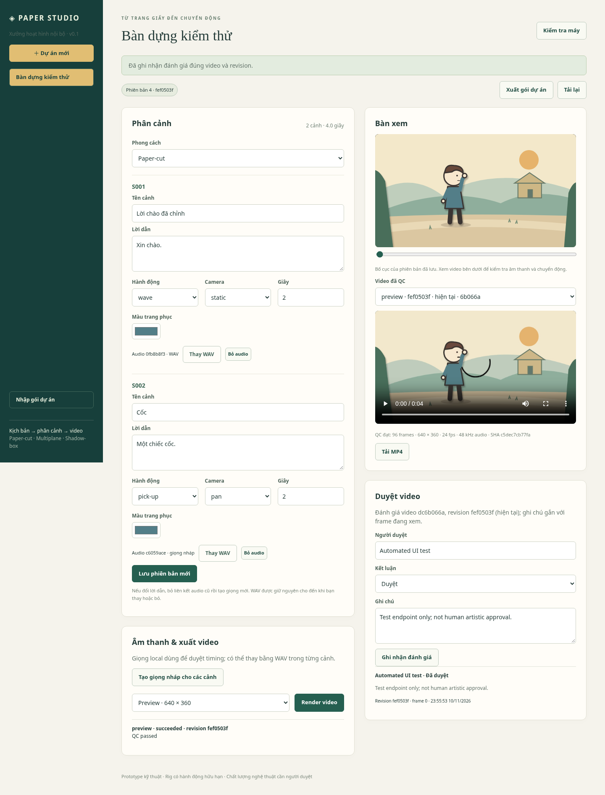

# Paper Studio — studio hoạt hình nội bộ

Ứng dụng chạy được từ **kịch bản → phân cảnh nháp → chỉnh cảnh/voice → render → QC → review → export/import**. Có web UI tiếng Việt và CLI dùng chung workflow. Bản 0.1 dùng để duyệt khả năng kỹ thuật và hướng hình ảnh; chưa tự diễn xuất mọi kịch bản.



## Chạy ngay

Môi trường đã thử: Linux Debian 13, Node **24.22.1**, Chromium **156**, FFmpeg/ffprobe **7.1.5**. Cần các executable `chromium`, `ffmpeg`, `ffprobe` trên máy.

```bash
npm ci
npm run studio -- doctor
npm run build
npm start
```

Mở **http://127.0.0.1:4310**. Browser render mặc định `/usr/bin/chromium`; đổi bằng `STUDIO_BROWSER` nếu cần. Xem [cài từ đầu và tái tạo](docs/reproduction.md) và [hướng dẫn sử dụng](docs/user-guide.md).

1. Chọn **Dự án mới**, nhập script; mỗi đoạn trống là một cảnh.
2. Kiểm tra action, camera, thời lượng; lưu phiên bản mới khi sửa.
3. Tạo giọng nháp hoặc đưa WAV riêng vào từng cảnh.
4. Render Preview để sửa nhanh; Final xuất 1080p.
5. Nghe/xem, ghi review đúng revision/frame; tải MP4 hoặc xuất gói dự án.

Không cần API key. Planner dùng quy tắc có chỉ dẫn; eSpeak cung cấp giọng nháp. Chất lượng giọng và chuyển động cần người dùng duyệt.

## Demo và kiểm chứng

- [Video 13 giây, 3 cảnh, 1080p](artifacts/morning-final.mp4), [gói mẫu mở lại được](artifacts/morning.studio.json).
- [Integration](artifacts/integration-results.json), [browser/UI](artifacts/ui-results.json), [nhật ký và giới hạn kiểm chứng](docs/verification.md).
- [Ảnh frame mẫu](artifacts/morning-frame.png).

```bash
npm run verify
npm run build
npm run test:integration
npm run test:ui
```

Test render thật cần Chromium và FFmpeg. Renderer giả trong unit tests chỉ kiểm state machine. Review do test tạo không được coi là duyệt nghệ thuật.

## Phạm vi hiện tại

| Có trong v0.1 | Giới hạn |
| --- | --- |
| Paper-cut, multiplane, shadow-box | Một rig và bố cục bằng code |
| Idle, wave, walk, pick-up, talk | Chưa place/release, retarget, pose substitution |
| Voice VI/EN nháp hoặc WAV | Miệng theo năng lượng audio, chưa alignment/viseme âm vị |
| Preview 640×360, final 1920×1080, 24 fps | Tối đa 12 cảnh, 240 giây; chưa portrait/alpha |
| Revision, attempts, cancel/retry, cache, QC, review | Một máy, một worker, một process sở hữu data |
| Export/import JSON tự đủ audio | Gói một revision; backup lịch sử cần data directory |

Xem [capability matrix](docs/capabilities.md). **Đủ 12 giai đoạn trong Word** được theo dõi tại [roadmap P0–P11](docs/roadmap-full.md); không gộp các phần production còn mở vào trạng thái hoàn tất MVP.

## Tài liệu dự án

- [Kế hoạch và trạng thái](plan.md), [từng mốc chi tiết](docs/phases/).
- [AGENTS.md](AGENTS.md), [agent.md](agent.md), [skills.md](skills.md), [skill contracts](skills/).
- [Kiến trúc](docs/architecture.md), [API](docs/api.md), [ADR renderer](docs/adr/0001-renderer.md).
- [Runbook](docs/runbook.md), [phát triển](docs/development.md), [third-party notices](THIRD_PARTY_NOTICES.md).

## Nghiên cứu Word gốc và thẩm định

Giữ nguyên các tài liệu đã bàn giao:

- [Word gốc](reports/Bao_cao_Studio_hoat_hinh_AI_HyperFrames_Remotion.docx?raw=true), [PDF 59 trang](reports/Bao_cao_Studio_hoat_hinh_AI_HyperFrames_Remotion.pdf?raw=true), [hash gốc](SHA256SUMS).
- [Thẩm định](reports/Tham_dinh_ky_thuat.md), [kế hoạch khảo sát ban đầu](reports/Ke_hoach_trien_khai.md), [Word thẩm định](reports/Tham_dinh_va_ke_hoach_Studio_AI.docx?raw=true).
- [Harness HyperFrames/Remotion](validation/README.md), tách biệt với ứng dụng.
- [Word bàn giao chương trình, kiểm thử và đủ 12 giai đoạn](reports/Ban_giao_Studio_noi_bo_v0.1.docx?raw=true).

Kế hoạch khảo sát là snapshot trước khi viết chương trình. Trạng thái hiện tại ở `plan.md` và `docs/roadmap-full.md`.
