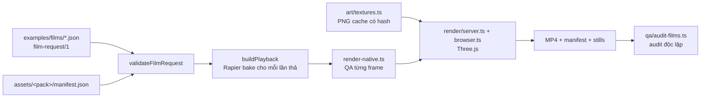

# Kiến trúc

Repo có hai phần, **chưa được nối với nhau** (nối là việc của G4):

| Phần | Thư mục | Làm gì |
| --- | --- | --- |
| Studio | `src/`, `web/`, `tests/` | Kịch bản → storyboard có revision bất biến → giọng đọc → hàng đợi render → review → export/import. Director lập kế hoạch có kiểm tra rồi gọi đúng các hàm của Studio. |
| Engine phim | `production/` | File phim (JSON) + art pack → lấy mẫu từng frame thuần → vật lý Rapier đã bake → lớp diễn xuất → renderer Three trong Chromium → MP4 1080p24 → audit độc lập. |

## Nguyên tắc mở rộng

**Code không biết tên nhân vật, đạo cụ, phim hay số frame cụ thể.** Thêm thứ mới bằng dữ liệu:

| Muốn thêm | Làm gì | Không cần sửa code khi |
| --- | --- | --- |
| Phim mới | Thêm `production/examples/films/<id>.json` (schema `film-request/1`) | Dùng nhân vật/đạo cụ có sẵn trong art pack |
| Đạo cụ mới | Thêm SVG + mục trong `manifest.json` của art pack, có anchor `grip` (và `support` nếu là mặt đỡ) | Luôn |
| Nhân vật mới | Thêm bộ phận `<model>/torso`, `upper-arm`, `forearm`, `thigh`, `shin`, `boot`, `hand-*`, `head-*` với anchor `end`/`sole`/`grip` | Cùng kiểu rig `production-cutout-1`. Độ dài xương lấy từ anchor của chính art đó |
| Art pack mới | Thư mục mới trong `production/assets/` và trỏ `artPack` của phim tới đó | Luôn; texture được rasterize và cache theo pack |
| Hành động mới (đi, vẫy…) | Cần code: một sampler thuần theo frame nhận tham số từ dữ liệu, có test trên ≥2 nhân vật | — |

## Engine phim (`production/`)

| Module | Trách nhiệm |
| --- | --- |
| `scene/types.ts`, `scene/geometry.ts`, `scene/math.ts` | Hợp đồng frame: sprite đặt theo pivot, stage 1920×1080, y hướng xuống |
| `scene/rig.ts` | Ráp con rối cắt giấy từ art pack. Độ dài xương lấy từ anchor `end`/`sole` của art; tư thế mặc định theo hồ sơ rig |
| `scene/background.ts` | Nền nhiều lớp có parallax theo camera |
| `motion/general-interaction.ts` | Hợp đồng tay–đạo cụ: chọn tay trái/phải, kiểm tầm với, kiểm art bắt buộc |
| `motion/general-timeline.ts` | `general-film/1`: keyframe, camera, đạo cụ sân khấu; lấy mẫu frame thuần (tua ngẫu nhiên được) |
| `motion/general-playback*.ts`, `physics/general-drop.ts`, `physics/engines.ts` | Tay giữ đạo cụ đến frame thả; sau đó bản bake Rapier (bất biến, có SHA) điều khiển đạo cụ |
| `motion/g3-performance.ts`, `scene/g3-*.ts` | Lớp diễn xuất tùy chọn (chuẩn bị → hành động → hồi): thân, hông, đầu, tay rảnh; giữ nguyên tiếp xúc và bàn chân |
| `qa/general-scene-quality.ts`, `qa/g3-visual-intent.ts` | QA từng frame: anchor tiếp xúc, đế giày chạm đất, layer, camera liên tục, đạo cụ có mặt đỡ |
| `art/pack.ts`, `art/textures.ts` | Đọc art pack; rasterize SVG → PNG một lần, kiểm hash mỗi lần dùng |
| `render/render-films.ts` | Lệnh chính: nhận file phim, bake, render baseline và (nếu có lớp diễn xuất) bản `-enhanced` cùng nguồn |
| `render/render-native.ts`, `render/server.ts`, `render/browser.ts` | Render từng frame trong Chromium, so state trình duyệt với state tính trước, mã hóa MP4, kiểm tua ngẫu nhiên |
| `render/check-renderer.ts` | Tự kiểm renderer: lỗi texture (404, hash, hỏng, chậm, timeout) phải chặn trước khi sẵn sàng; tua theo mọi thứ tự cho kết quả giống hệt |
| `qa/audit-films.ts` | Audit độc lập sau render: decode toàn bộ MP4, hash, nguồn, tái lập vật lý, QA lại từng frame, A/B chỉ khác lớp diễn xuất |

Bất biến: lấy mẫu thuần theo frame (không đồng hồ, không trạng thái tích lũy); input/art/bake đều có SHA; đầu vào sai, bake cũ, tầm với không tới thì **dừng với mã lỗi**, không fallback âm thầm.

## Studio (`src/`, `web/`)

`domain` định nghĩa schema, timebase và lỗi. `planner` chuyển kịch bản thành bản nháp (đoán hành động theo động từ, không theo tên đồ vật). `store` giữ asset/revision/job/artifact/review, ghi JSON bằng file tạm + rename. `application` là service dùng chung cho HTTP và CLI. `director` lập đồ thị việc có SHA, chỉ chạy sau khi người dùng duyệt.

Renderer được tiêm qua `RenderFunction` (`src/render.ts`). Hiện chưa có renderer nào được nối: job render kết thúc `failed` với `RENDERER_NOT_CONFIGURED` và không công bố artifact. G4 sẽ cài một `RenderFunction` chuyển revision của Studio thành file phim cho `production/`.

Revision bất biến; review gắn với đúng artifact/revision; sửa project tạo revision mới và không kế thừa duyệt. Một worker; khi khởi động lại, job đang chạy được đánh dấu `interrupted`. Server chỉ bind `127.0.0.1` và từ chối origin lạ.

## Kiểm tra

| Lệnh | Kiểm gì |
| --- | --- |
| `npm run verify` | Format, typecheck, unit test Studio |
| `npm run test:ui`, `npm run test:ui:recovery` | Luồng trình duyệt thật của Studio |
| `npm --prefix production run typecheck && npm --prefix production test` | Hợp đồng engine phim, tất cả phim mẫu hợp lệ và bake được |
| `npm --prefix production run render -- examples/films/*.json --out out/films` | Render thật mọi phim mẫu |
| `npm --prefix production run audit -- out/films` | Audit độc lập kết quả render |
| `npm --prefix production run check:renderer -- examples/films/an-right-cup.json` | Lỗi texture và tua frame |

CI: `.github/workflows/ci.yml` (mọi PR) và `render.yml` (khi `production/` đổi; upload phim làm artifact 14 ngày). CI xanh **không** phải chấp nhận nghệ thuật.
