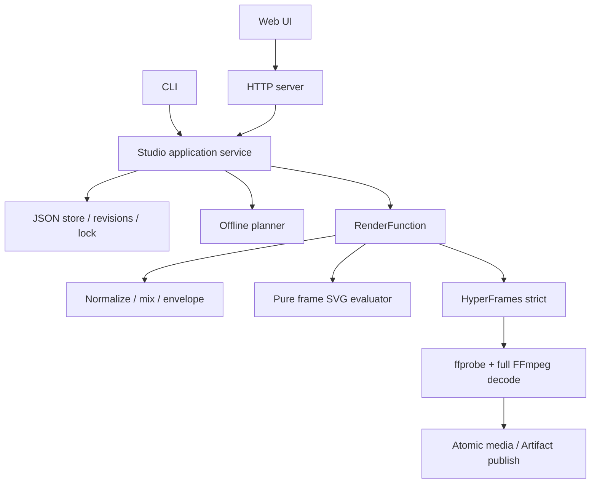

# Kiến trúc vòng đầu

`domain` định nghĩa schema, timebase và lỗi. `planner` chuyển kịch bản thành draft. `store` giữ asset/revision/job/artifact/review. `render` sinh HTML từ dữ liệu đã validate, gọi HyperFrames và QC. `server` cung cấp HTTP; `web` là client; `cli` dùng lại application service.

Không có phụ thuộc ngược từ domain vào HTTP/browser. Dữ liệu người dùng được escape khi sinh HTML; không nhận code tùy ý. Asset là bytes local có hash. Browser executable, FFmpeg và voice engine được kiểm bởi doctor.

Một Project có nhiều Revision bất biến. Một RenderJob chỉ vào một revision/profile, có nhiều attempt; chỉ một worker chạy. Artifact chỉ được công bố sau QC. Review chỉ đúng cho artifact/revision cụ thể; sửa project tạo revision mới và không kế thừa approval.

Cache vòng đầu ở cấp toàn project: key gồm nội dung render, asset hashes, profile, phiên bản compiler/backend. Cache hit phải kiểm file/hash. Cache theo shot là bước tiếp theo sau pilot; chưa hứa locality tối ưu khi sửa thoại.

Khi khởi động lại, job từng running được đánh dấu interrupted, không coi file tạm là output. Retry tạo attempt mới. Cancel truyền AbortSignal xuống renderer. Export/import dùng JSON và asset bytes đã hash; không giải nén đường dẫn do người dùng cung cấp.

## Module và chiều phụ thuộc

## Data directory

`projects/` giữ current pointer và revision IDs; `revisions/` giữ immutable spec/digest/notes; `assets/` là metadata audio hash; `jobs/` giữ attempts/state; `artifacts/` là metadata QC/hash; `reviews/` là review records. `media/` chứa WAV theo SHA và MP4 theo Artifact ID; `tmp/attempt_*` giữ composition/log/output chưa published; `cache/` là cache backend.

Ghi JSON bằng temporary file + rename; store.transaction serialize các chuyển state/optimistic write trong một process. `.studio.lock` chặn writer thứ hai. Đây không phải multi-process database transaction hoặc cam kết power-loss durability.

## Timebase và hình học

Project 24 fps cố định, scene duration nguyên frames, tổng timeline là các khoảng nửa mở `[startFrame,endFrame)`. Audio mono 48 kHz tương ứng đúng 2.000 samples/frame. Mixer đặt voice tại đầu scene, pad silence đến scene end; nếu audio dài hơn slot thì lỗi.

Rig dùng viewBox 640×360, gốc trái trên, x sang phải/y xuống; SVG scale tới output profile. Camera dịch các lớp theo tỷ lệ parallax; action tính từ local frame thuần, không dùng clock/random. Biểu thức mouth dùng RMS audio theo frame, không phải phoneme cue.

## Integrity và publication

Enqueue kiểm revision/project và audio hashes; renderer validate lại spec và mixer kiểm duration. HyperFrames ghi file trong attempt. QC kiểm toàn bộ decode trước rename vào media; Artifact record được ghi trước khi job succeeded. Crash có thể để orphan file/record chưa gắn job nhưng không được gọi là succeeded; cần recovery/retention mở rộng ở P9. Artifact không bị overwrite bởi retry. Export chỉ có spec/assets, không credential/path cũ/approval.
