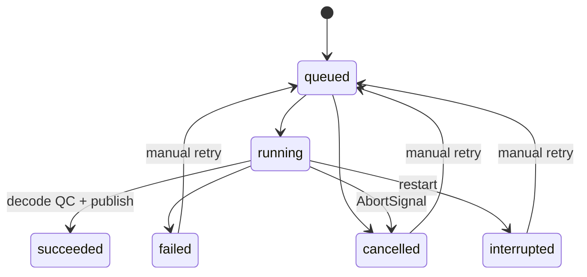

# Runbook nội bộ

## Quan sát

- Doctor kiểm executable/version. Server bind 127.0.0.1; host/origin ngoài localhost bị từ chối. Chưa có login/roles; không triển khai public qua reverse proxy.
- GET `/api/health`: worker khỏe trả 200; lỗi điều phối nền trả 503 và code/message.
- `DATA/jobs/*.json`: state/attempt/error/cache/progress. `DATA/tmp/attempt_*/render-log.json` và `failure.json`: log. Không sửa records bằng tay.

Retry thêm attempt. Succeeded cần job mới. Duplicate submit lúc queued/running trả cùng job. Cache key gồm spec/audio hashes/profile/runtime/compiler; reuse phải verify hash. Hiện cache cấp project, chưa cấp shot/stem.

## Xử lý lỗi

| Lỗi | Cách xử lý |
| --- | --- |
| STORE_IN_USE | Dừng writer đang sở hữu data; không chạy CLI/server cùng data. |
| INVALID_LOCK | Kiểm PID/process và backup; chỉ xóa lock sau khi chắc không có writer. Dead PID được tự xử lý. |
| REVISION_CONFLICT | Đọc current revision, áp dụng lại patch muốn giữ, gửi expectedRevision mới. |
| Asset thiếu/sai hash | Restore WAV đúng hash hoặc upload mới thành revision mới. |
| AUDIO_OVERFLOW | Tăng duration hoặc thay WAV, vẫn giữ tổng ≤240s. |
| QC_FAILED/PROCESS_FAILED | Giữ attempt log, doctor, kiểm disk/RAM, sửa nguyên nhân rồi retry. |
| Worker dừng | Restart; running → interrupted; queued tiếp tục; retry interrupted thủ công. |
| Cache/MP4 bị sửa | Cache bị bỏ qua; tạo render mới. Review hash sai bị chặn. |

Chỉ output có Artifact record và media khớp hash mới được giao. Atomic rename bảo vệ trước dừng process; chưa chứng minh chống mất điện bằng fsync transaction. Fault matrix đầy đủ giữ mở tại P9.

## Backup/restore

1. Dừng ứng dụng. Backup projects, revisions, assets, jobs, artifacts, reviews, media, Git commit và package-lock. tmp/cache không bắt buộc để replay.
2. Restore vào thư mục mới, không đè studio đang chạy; không restore `.studio.lock` máy cũ.
3. Dùng đúng checkout, chạy doctor, mở với STUDIO_DATA mới; kiểm history/artifact hashes và render preview.
4. Package round-trip một project đã được test. Restore full history trên máy khác vẫn là ca P9 chưa nghiệm thu.

## Dung lượng và nâng phiên bản

Dừng studio trước khi dọn tmp/cache. Không xóa media theo ngày: revision cũ có thể còn tham chiếu. Chưa có garbage collector. Backup trước upgrade; chạy verify/integration/UI và giữ evidence trước/sau. Bump compiler version khi thay ý nghĩa render. Schema hỗ trợ 1.0; version khác bị từ chối, chưa migration ngầm.
