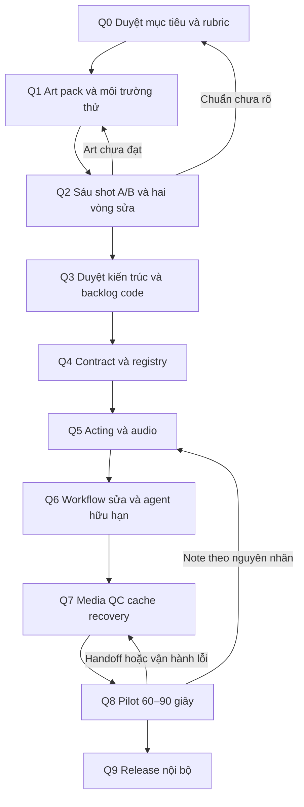

# Kế hoạch thực hiện sau nghiên cứu toolchain

Ngày: **11/11/2026**. Bản này bổ sung [Q0–Q9](production-quality-plan.md) và [P0–P11](roadmap-full.md); không thay thế lịch sử M0–M6, không tự đóng gate. **Mọi công việc triển khai ở đây chưa bắt đầu và chờ duyệt.** Vòng nghiên cứu hiện tại chỉ chạy harness/CLI có sẵn, giữ code/dependency/schema ứng dụng nguyên trạng.

## 1. Trình tự và nguyên tắc thực hiện

1. Q2 dùng **prototype nghiên cứu tách biệt** sau khi người dùng duyệt viết fixture/adapter cần thiết. Không cần xây registry/editor/agent production trước để so A/B; đồng thời không giả định những phần đó đã có.
2. A = art pack + Three/Canvas + HyperFrames. B = cùng brief/art direction trong Blender 2.5D. Chỉ mở thêm một authoring tool nếu A/B bộc lộ blocker cụ thể; generative có trần phí riêng.
3. Mỗi item chạy vòng: khóa input/expected → làm → test → lưu cả fail → sửa nguyên nhân → chạy lại phần liên quan → review → cập nhật trạng thái. Không hạ ngưỡng sau khi thấy kết quả.
4. Kết quả cũ và accepted artifact bất biến. Thay thiết kế/timing/asset tạo revision mới; ghi tác động tới shot/phần timeline khác. Không đổi approval theo suy luận.
5. Artist/animator là vai bắt buộc cho chất lượng, có thể do một người kiêm. AI đề xuất/đo; người có thẩm quyền duyệt art. Vai không đồng nghĩa đã có nhân sự hoặc đủ năng lực.
6. Khi user duyệt một phạm vi cụ thể, tiếp tục các bước phụ thuộc đã được phép, không hỏi lại quyền cho từng thao tác thường lệ. Scope code ngoài phạm vi đã duyệt, phí mới hoặc đổi art target cần quyết định riêng.

### Vai trò

| Ký hiệu | Trách nhiệm |
| --- | --- |
| PO | Người dùng/producer: mục tiêu, phạm vi, ngân sách, duyệt cuối |
| AD | Art director/illustrator: style bible, model sheet, art consistency |
| AN | Animator/technical artist: rig, pose, acting, contact, khả năng sửa |
| PE | Pipeline engineer: contracts, renderer, data/version, QC/recovery |
| SE | Sound/editor: voice, timing, viseme phối hợp AN, stems/mix/handoff |
| QA | Kiểm thử và người tái tạo độc lập: negative tests, evidence, regression |

## 2. Quy ước ước lượng và trạng thái

Hiện chưa có công làm art/rig/animation thật, chưa chốt đội và máy. Vì vậy **chưa đưa deadline/ngân sách production bằng số**. Đây là thiếu dữ liệu đã xác định, không phải công việc bị bỏ qua. Mỗi stage dưới đây ghi cách lấy số còn thiếu.

- `E0`: chưa đủ dữ liệu ước lượng; cần đo được nêu tại stage.
- `E1`: sau một tác vụ đại diện, báo từng mẫu và khoảng, độ tin cậy thấp; không nội suy tuyến tính từ demo procedural.
- `E2`: sau pilot và hai vòng sửa, ước lượng có điều kiện theo số shot/asset/diễn viên/ngôn ngữ tương tự; vẫn không là SLA.
- Công theo vai tính bằng **giờ thực làm**; ghi chờ render và chờ review riêng. Lịch theo ngày chỉ tính sau khi có số giờ/tuần của từng người và đường phụ thuộc.
- Chi phí = công người quy đổi (nếu có đơn giá) + compute/API mọi take + license + storage/egress + QC/rework + setup phân bổ. Nếu chưa có đơn giá, báo giờ công và tiền dịch vụ riêng. Phút accepted bằng 0 thì chi phí/phút **chưa xác định**, không ghi 0.
- Trần paid API/GPU/license hiện tại: **0**. Phương án mua/thuê phải kèm model/region/config, số take, giá được kiểm lúc xin duyệt, trần tiền và điều kiện dừng. Không mua GPU để đáp ứng thông số README chưa benchmark.

## 3. Kế hoạch chi tiết Q0–Q9

### Q0 — mục tiêu hình ảnh, diễn xuất và phạm vi pilot

**Nối:** P0. **Trạng thái:** NOT_STARTED, chờ người dùng duyệt triển khai. **Chủ trì:** PO + AD + AN.

- **Vấn đề/mục tiêu:** chuyển “đẹp và chuyển động tốt” thành reference và lỗi chặn có thể review; kế thừa paper-cut, shadow-box, multiplane trong Word.
- **Đầu vào/phụ thuộc:** Word §2/3/11, demo đã có, báo cáo vòng 1/2, quyền dùng reference. Chưa cần backend mới.
- **Q0.1:** chọn một style đầu cho pilot; làm rõ matte/texture/line weight, silhouette, shadow được cách điệu thế nào, camera được đi tới đâu. Hai style còn lại vẫn có backlog F01.
- **Q0.2:** chọn hero, bối cảnh và kịch bản pilot 60–90 s; profile đề xuất 1080p/24 fps SDR, ngôn ngữ theo kịch bản. Profile chỉ khóa khi PO duyệt.
- **Q0.3:** chọn video reference cho anticipation/weight/contact/hold/on-twos; ghi timestamp và điều muốn học. Một moodboard ảnh không đủ định nghĩa motion.
- **Q0.4:** duyệt rubric Q plan: art 30%, acting 35%, layout 15%, continuity 10%, sửa 10%; ngưỡng ≥80/100 và art/acting từng mục ≥4/5 **chỉ là đề xuất**. Ghi điều kiện từng shot và lỗi chặn, reviewer, màn hình/player.
- **Đầu ra:** brief có revision, reference register, bảng must-have/optional, rubric, output/audio profile nháp, shot list. Có thể duyệt từng mục cụ thể.
- **Gate/test/evidence:** PO duyệt reference hình và motion, identity/style/pose/camera constraints; ghi approval đúng version. Không chạy benchmark art khi chuẩn này chưa khóa.
- **Rủi ro/fallback/fail:** reference mâu thuẫn → chọn một target nhỏ và làm styleframe lại Q0; không dùng renderer để giải thích một target chưa thống nhất.
- **Ước lượng:** E0; đo giờ chọn/chú giải reference + số vòng duyệt. Sau Q0.1 có thể ước lượng phần styleframe Q1 theo complexity; chưa cam kết lịch.

### Q1 — art pack thử đủ để dựng và sửa

**Nối:** P1/P2. **Trạng thái:** NOT_STARTED. **Chủ trì:** AD + AN; PE phụ trách môi trường/license, QA kiểm đầu vào.

- **Vấn đề/mục tiêu:** có asset thật thay hình procedural; tránh kết luận backend kém vì thiếu tay/mặt/vùng nền khuất.
- **Đầu vào:** Q0 được duyệt, brief sáu shot và animatic timing sơ bộ, output profile. Giữ các fixture cũ làm regression kỹ thuật riêng.
- **Q1.1:** ba styleframe wide/close-up/contact; palette, texture density, line/shadow language. AD duyệt alpha trên trắng/đen và pose silhouette.
- **Q1.2:** model sheet front/3⁄4/profile theo shot; neutral/expressions, mouth/hand variants, extreme pose và pose cần drawing riêng. Không hứa mọi góc từ một ảnh.
- **Q1.3:** tách part có overlap, pivot/anchor/world scale; prop có grip/placement; nền foreground/middle/background + overscan theo camera. Ghi tên/hash/version/quyền và native editable source.
- **Q1.4:** khóa A/B versions; Three/HyperFrames và Blender release/plugin/color config. Giữ npm lock nghiên cứu khác app. Kiểm code/runtime/font/voice/asset/model weights riêng. Nếu dùng Manim, bổ sung Cairo/Pango/Python/PyAV hoặc OpenGL theo nhánh.
- **Q1.5:** dùng một voice được duyệt và beat timing cho A/B. Tách artwork chung khỏi representation từng backend; việc chuyển sang mesh/layers/bones phải được tính công.
- **Đầu ra:** source pack + manifests, sheet cực trị/alpha/anchors, ba styleframes, audio/animatic, môi trường tái tạo và license matrix.
- **Gate/test/evidence:** đủ inputs cho S01–S06; không còn asset thiếu/quyền chưa rõ; PO duyệt hình; QA xác minh hash/bounds/missing assets trước animation. Qwen tách lớp chỉ là hỗ trợ, artist vẫn kiểm vùng khuất.
- **Rủi ro/fallback/fail:** mất silhouette/khớp hở → sửa art Q1.2/3; góc quay không khả thi → pose replacement hoặc sửa camera qua Q0. Không giảm chất lượng âm thầm để qua gate.
- **Ước lượng:** E0 → E1 sau khi làm một hero pose sheet, một prop và một background. Đo giờ art, cleanup, rig conversion A/B và sửa riêng; đây là dữ liệu lập ngân sách Q2.

### Q2 — bằng chứng để chọn phương án

**Nối:** P3 và các phép thử P2/P6/P7/P9. **Trạng thái:** NOT_STARTED; các phép CLI vòng nghiên cứu chỉ hỗ trợ preflight. **Chủ trì:** AN + PE + QA; AD/PO review.

- **Mục tiêu:** chứng minh hình/motion/sửa/tái tạo trên cùng brief, không chỉ xuất MP4.
- **Đầu vào:** Q1 đạt; shortlist A/B và quyền viết prototype/harness nghiên cứu mới được PO duyệt. Không gắn trial trực tiếp vào code v0.1.
- **Q2.1:** chạy bộ hợp đồng kỹ thuật ở mục 4, gồm native Three loading, media color/alpha, random seek, reset/reload. Với dữ liệu lỗi phải chặn đúng nguyên nhân.
- **Q2.2:** dựng blocking S01–S06 trên A/B; review silhouette/intent/contact trước texture/polish. Mỗi backend dùng representation phù hợp, cùng duration/audio/beats/native output và scope camera.
- **Q2.3:** polish, xuất video từng shot và sequence; ghi native/output size/fps, upscale/interpolation. Xem tốc độ thật, chậm và frame lỗi, không chỉ poster/contact sheet.
- **Q2.4:** hai vòng sửa bắt buộc như mục 4; giữ trước/sau/take bị loại, thời gian thao tác, dependencies thay đổi, re-render scope. Người khác mở và sửa một note.
- **Q2.5:** chỉ sau khi hình đạt mới đo 3 cold + 5 warm theo cache được định nghĩa; peak RAM gồm browser/subprocess, GPU có thiết bị/công cụ đo; công bố samples/median/range, không tuyên bố SLA p95.
- **Đầu ra:** 12 video shot tối thiểu cho A/B, source editable, measurements/timesheets, review từng shot, failure log, hai vòng sửa và bảng gate. Tổng 48 s/candidate là fixture, không phải phim pilot Q8.
- **Gate:** mỗi hard gate của cả sáu shot đạt; ít nhất một nhánh đạt art/motion và sửa được. Nếu chỉ một nhánh đạt, không cần ép nhánh kia tiếp tục vô hạn; ghi lý do loại với evidence.
- **Rủi ro/fallback/fail:** art fail → Q1; action/contact fail → sửa prototype Q2; readiness/seek fail → sửa adapter nghiên cứu và chạy lại; cả A/B fail → chưa Q3, thu hẹp scope hoặc thử **một** authoring fallback theo blocker. Không thêm model để che lỗi chưa hiểu.
- **Ước lượng:** E1 sau Q1; `giờ/candidate = setup + chuyển art/rig + tổng giờ six shots + hai vòng sửa + QC/replay`. Tính effort mọi take. Chỉ budget nhánh C/D của Q plan cũ khi được kích hoạt; timebox cũ G1 không tự áp cho sáu shot phức tạp.

### Q3 — ADR và phạm vi triển khai có thể duyệt

**Nối:** P3/P1/P11. **Trạng thái:** NOT_STARTED. **Chủ trì:** PE + AD + PO.

- **Mục tiêu:** chọn backend chính bằng video và công sửa; quyết định interface nhỏ nhất cần xây.
- **Đầu vào:** Q2 artifacts/measurements/notes, license matrix và capacity đội thực.
- **Q3.1:** so A/B theo hard gates trước; nếu cùng đạt thì so công sửa, reuse, vận hành và tổng effort. Tách lỗi tool, lỗi authoring và lỗi asset.
- **Q3.2:** ADR chọn/loại, giới hạn multi-view/actor/camera/material; chỉ thêm backend phụ khi có shot cần và handoff test đạt.
- **Q3.3:** khóa media contract, capability/error matrix; xác định Q4–Q7 thay đổi nào tối thiểu và cách replay dự án v0.1.
- **Q3.4:** lập dự toán theo số đo Q2, vai/giờ thực, license/compute/retention, các giả định còn yếu; chia milestone để review, mỗi milestone có rollback.
- **Đầu ra/gate:** ADR PROPOSED kèm video trước/sau sửa, bảng costs và backlog có scope; PO duyệt thành ACCEPTED trước khi code sản phẩm. Không đánh dấu phần chưa chứng minh là supported.
- **Test/evidence:** truy ngược mỗi lý do lựa chọn tới shot/test/measurement; QA kiểm không lấy ảnh đẹp riêng lẻ thay result sáu shot.
- **Rủi ro/fallback/fail:** thiếu evidence hoặc quyền tool → Q1/Q2 đúng phần thiếu; giữ ADR hiện tại của v0.1, không rewrite theo hype.
- **Ước lượng:** E1; đo effort tổng hợp/review và số câu hỏi còn mở. Lịch code chỉ đặt sau Q3.4.

### Q4 — asset/rig/scene contract và migration

**Nối:** P4/P5. **Trạng thái:** NOT_STARTED. **Chủ trì:** PE + AN; QA kiểm dữ liệu.

- **Vấn đề:** schema 1.0 chỉ audio/action enum; cần assets/instances/rig cần thiết cho shot đã chứng minh.
- **Đầu vào:** Q3 approved capabilities, Q1 art/source, dữ liệu v0.1 làm regression.
- **Q4.1:** định nghĩa ID/version, frame interval hữu tỉ, transform order, units/world/local/screen, camera projection, anchor/contact và alpha/color conventions bằng ví dụ từ Q2.
- **Q4.2:** ingest image/rig/native source; immutable AssetRevision, source/rights/hash, dependencies và trạng thái draft/approved; kiểm decode/bounds/alpha trước publish.
- **Q4.3:** representation/backend capability; unsupported effect/view trả lỗi; giữ native project khi IR không bảo toàn constraint. Không ép một IR tổng quát chứa mọi feature của Blender/Spine/Manim.
- **Q4.4:** migration có chủ đích hoặc từ chối rõ; export/reopen gồm mọi dependency cần; compiler/backend/asset/rig/color version là fingerprint thực, không chỉ chuỗi cập nhật tay thiếu kiểm soát.
- **Đầu ra:** schema/ADR/API docs, registry, examples, migration fixtures, dependency graph và source package tái tạo được.
- **Gate/test:** missing/hash/cycle/anchor/range/unsupported inputs bị chặn; export/import/replay khóa input; approval cũ không truyền qua asset mới; scene v0.1 giữ được bằng môi trường cũ hoặc migration đã kiểm.
- **Rủi ro/fallback/fail:** schema quá rộng → quay Q3 chọn capability nhỏ; mất source fidelity → lưu native editable shot, công khai mapping loss; fail migration → giữ version cũ và sửa Q4.
- **Ước lượng:** E1; đo một asset ingest + một rig + một shot round-trip rồi ước lượng theo số loại contract. Không nhân số file đơn thuần thành thời gian triển khai.

### Q5 — acting, contact và audio có thể sửa

**Nối:** P6/P7. **Trạng thái:** NOT_STARTED. **Chủ trì:** AN + SE; PE hỗ trợ solver/cue, AD duyệt.

- **Đầu vào:** Q4 contracts, Q2 accepted motions/art, voice/ngôn ngữ pilot.
- **Q5.1:** phases anticipate/reach/grip/lift/hold/place/release, marker/attachment giữ transform; foot lock theo pha trụ và root displacement; test pan để tách world/screen drift.
- **Q5.2:** eye-line/blink/expression/reaction/settle; cadence có chủ ý; pose replacement cho góc vượt rig. Reference motion không chỉ là easing preset.
- **Q5.3:** audio/transcript/cues theo hash; corpus tối thiểu 20–30 câu/ngôn ngữ với silence/tốc độ/âm cuối; map viseme và editor sửa cue, nghe/phát âm do người duyệt.
- **Q5.4:** stems dialogue/music/ambience/SFX, channel map, gain, output profile loudness/true peak; alignment không bị coi là thiết kế diễn xuất của miệng.
- **Đầu ra:** library actions có phạm vi, QA clips/contact report, cue/source/timesheets và stems.
- **Gate/test/evidence:** sáu shot đạt trong pipeline mới; marker ≤2 px ở 1080p cho fixture khóa (ngoại lệ style duyệt trước); transport sync ≤1 frame; cue speech ±2 frame cho mốc perceptual dễ nhận chỉ khi được Q0/Q5 duyệt. Mọi threshold ghi trước chạy; không trộn ba phép đo.
- **Rủi ro/fallback/fail:** solver không giữ silhouette → drawing/pose swap hoặc Q1 thêm view; lip-sync VI kém → manual cues, thu/đổi voice đúng quyền; fail movement → sửa blocking Q5.1 trước thêm effect.
- **Ước lượng:** E1 theo action family/rig và công sửa cue; ghi tỷ lệ reuse, số pose riêng và giờ/shot. Chưa gọi “tự động x%” khi chưa có denominator giờ công.

### Q6 — sửa shot, review và agent hữu hạn

**Nối:** P8 và workflow P4/P5/P10. **Trạng thái:** NOT_STARTED. **Chủ trì:** PE + AN/SE; QA kiểm workflow; PO duyệt UX.

- **Đầu vào:** Q4/Q5 capabilities, note thật từ Q2, source editable.
- **Q6.1:** storyboard/animatic, sửa duration/reorder trong phạm vi chứng minh; shot/pose/camera/cue controls theo thao tác animator cần; undo/revision/rollback giữ accepted work.
- **Q6.2:** proxy có revision/capability label; preview đủ parity với final cho thứ được review. SVG storyboard hiện tại không thay preview mouth/audio final.
- **Q6.3:** review frame/timestamp, compare revision, note theo nguyên nhân, công khai stale dependencies; chọn đúng artifact/profile trước approve.
- **Q6.4:** agent chỉ khi task catalog ổn định: tool schema/expected revision, bounded patch, capability refusal, usage/traces. Giữ manual workflow nếu chưa chọn provider; stage không bỏ qua mà ghi NOT_RUN phần provider phụ thuộc ngân sách.
- **Đầu ra:** workflow sửa có thể thao tác, skill/API contracts cập nhật, eval corpus 20 đúng + 20 lỗi, video thao tác/trace có log.
- **Gate/test:** đổi thoại/asset/pose/camera và rollback không mất unrelated accepted shot; conflict/cancel/unsupported/injection vào text bị xử lý đúng; đúng JSON chưa đủ, người dùng/AN duyệt kết quả nội dung. Review giả trong test không đóng art note.
- **Rủi ro/fallback/fail:** controls khó dùng → Q4/Q5; patch ngoài scope → chặn và manual edit; provider lỗi/phí → dừng provider, tiếp tục chức năng người biên tập.
- **Ước lượng:** E1 theo tác vụ sửa thật và số controls cần. Đo thời gian click/sửa/review trước/sau; không mặc định phải có timeline editor tổng quát.

### Q7 — media contract, QC, cache và recovery

**Nối:** P1/P9, master P7/P11. **Trạng thái:** NOT_STARTED. **Chủ trì:** PE + SE + QA.

- **Đầu vào:** Q3 backend, Q4 dependency graph, Q5 stems, Q6 sửa có scope; máy vận hành được chọn.
- **Q7.1:** chọn sequence/intermediate/master/delivery riêng. Khai straight/premultiplied, scene/display referred, transfer/primaries/matrix/range, scaling; đừng chỉ set metadata. Kiểm trên nền sáng/tối, saturated/gradient/shadow và target player.
- **Q7.2:** QC decode/frame/profile/hash + required assets + media color/alpha/audio loudness; blank/frozen detector có exemption hold/black có chủ ý. Giữ technical QC tách art approval.
- **Q7.3:** cache shot/stem gồm đầy đủ dependency/backend/compiler/renderer/color/profile/environment; explain invalidation; đổi gain nhạc không render lại hình khi contract cho phép.
- **Q7.4:** fault matrix load/capture/encode/QC/publish; disk full, corrupt cache, GPU context lost, duplicate/cancel/restart; chỉ published artifact được QC/hash, không lấy file tạm làm success.
- **Q7.5:** backup full history, restore data mới/máy sạch, kiểm hashes và sửa/rerender; đo RPO/RTO thực trước đặt cam kết; quota/retention theo measured disk.
- **Đầu ra:** output profiles, QC report/fault evidence, cache diagnostics, environment manifest và runbook rehearsal.
- **Gate:** các ca âm/dương đúng; no silent fallback/published partial; clean replay giữ nội dung trong tolerance khóa; accepted history restore được. Chỉ nói bit-exact trong môi trường đã đo.
- **Rủi ro/fallback/fail:** màu sai → Q7.1 hoặc Q1 source color; GPU nondeterminism → bake/CPU/fixed step với cost rõ; cache sai → invalidation an toàn/rerender cho tới khi sửa; không chuyển Q8 khi integrity gate fail.
- **Ước lượng:** E1 theo matrix workload và số backend thực. Giờ debug/retry/storage đo riêng; một bản MP4 64×64 pass alpha CLI không phải estimate test production.

### Q8 — pilot production và hai vòng sửa

**Nối:** P10. **Trạng thái:** NOT_STARTED. **Chủ trì:** PO + AD/AN + SE + PE/QA.

- **Đầu vào:** Q5–Q7 đạt trong scope, kịch bản/animatic Q0 được duyệt và năng lực đội thực.
- **Q8.1:** làm phim 60–90 s, 6–9 shot có kể chuyện; storyboard → animatic → blocking → animation → composite → mix → review. Không thay bằng ghép sáu fixture.
- **Q8.2:** hai vòng sửa thoại/asset/pose/camera/dựng, log phạm vi và mọi take; không xóa bản trước để làm chi phí thấp hơn.
- **Q8.3:** người không dựng ban đầu mở source ở môi trường sạch, sửa một note và render; kiểm native project/asset/fonts/stems/references.
- **Q8.4:** tổng hợp art score từng shot/sequence, issues, thời gian theo vai, compute/license/storage/failed takes; cost/minute chỉ dùng duration PO đã duyệt.
- **Đầu ra:** phim accepted + master/delivery, source/history package, review notes, timesheets/cost sheet và limitations.
- **Gate:** PO duyệt phim, không lỗi chặn, source sửa lại được, đủ số đo cho E2. Chỉ đủ màn hình UI hoặc exit 0 không đạt stage.
- **Rủi ro/fallback/fail:** art/continuity → Q1/Q5/Q6 theo note; workflow/media → Q7; thiếu dữ liệu effort → bổ sung log và giữ estimate E1. Không bỏ note vì sát deadline.
- **Ước lượng:** E1 từ Q2 với complexity từng shot và reuse thực; chuyển E2 sau Q8.4. Báo tổng pilot lẫn steady-state có phân bổ setup, không dùng một số che cả hai.

### Q9 — release nội bộ và vận hành

**Nối:** P11, duy trì P1/P9. **Trạng thái:** NOT_STARTED. **Chủ trì:** PE/operator + PO + QA.

- **Đầu vào:** Q8 accepted, scope/cost/support owner rõ. Nội bộ một nhóm, chưa tự mở SaaS.
- **Q9.1:** release/tag, source/asset notices, capabilities/unsupported cases; training operator/artist, dự án mẫu và runbook.
- **Q9.2:** cập nhật AGENTS.md, agent.md, skills.md/SKILL.md, plan/changelog, ADR/schema/API theo feature thật; không tạo docs giả đã có.
- **Q9.3:** quyền truy cập/reviewer, backup/retention/quota, provider budget nếu có, upgrade/rollback goldens; thêm nhiều worker chỉ sau khi đo bottleneck và test isolation.
- **Q9.4:** shadow operation có operator khác thực hiện create/edit/render/review/export/recover; PO duyệt release. Push code/evidence lên branch/PR review, không tự merge hoặc phát hành video.
- **Đầu ra/gate:** internal release được PO duyệt, checklist vận hành thật, lỗi mở có owner/severity, số đo chất lượng/cost/throughput. Stage fail → quay Q7/Q8 đúng nguyên nhân.
- **Rủi ro/fallback:** chưa có operator/rights → giữ pilot có giám sát, không tuyên bố production unattended. SaaS là dự án quyết định riêng.
- **Ước lượng:** E2 chỉ trong phạm vi pilot; đo số giờ training/support và rehearsal upgrade/restore trước cam kết vận hành.

## 4. Bộ thí nghiệm quyết định và điều kiện chạy

### Sáu shot giữ nguyên intent từ kế hoạch trước

| ID | Dài đề xuất | Nội dung | Gate chính và evidence |
| --- | --- | --- | --- |
| S01 | 8 s | Cận mặt, nghe tin, đổi cảm xúc, thoại, giữ phản ứng | Video/audio tốc độ thật, face/viseme cues, eye-line, identity; lỗi timestamp |
| S02 | 8 s | Walk → giảm tốc → stop → turn, pan nhỏ | Ground/foot markers có bù camera, root/stride/contact, silhouette lúc turn |
| S03 | 10 s | Reach → grip → lift → hold → place → release | Anchor distance theo từng frame grip, parent-switch transform, weight/settle |
| S04 | 8 s | Camera qua nhiều lớp, occlusion, shadow/focus | Overscan/camera bound, alpha trên trắng/đen, shadow plane, full-frame playback |
| S05 | 8 s | Hai nhân vật nhìn/chuyền prop/phản ứng lệch nhịp | Ownership/contact handoff, eye-line/screen direction, state isolation |
| S06 | 6 s | Pose khó/anticipation/cao trào/settle | Rig extremes/foreshortening, drawing replacement, cadence và recognition |

48 s là proposal trước Q1. Khi khóa benchmark, thay brief phải tạo version mới và chạy các đối chứng liên quan; không chỉnh một phía để dễ pass.

### Các test mới cần quyền viết fixture/harness, hiện NOT_RUN

| ID | Câu hỏi/thiết kế | Expected khóa trước chạy | Artifact; khi fail |
| --- | --- | --- | --- |
| T-THREE-01 | Cùng cutout: plane alpha, camera orthographic/perspective có giới hạn, shadow, postprocess; seek forward/reverse/random/new process | Pose/state giống; raster trong tolerance theo device; không halo/rectangular shadow/lộ mép | PNG/sequence/video + state/GL/device manifest; sửa representation hoặc Q1 |
| T-THREE-02 | Vanilla r187 LoadingManager, ESM/global, texture tải trễ/404/corrupt, custom manager; kiểm readiness tại frame 0 | Required texture phải ready đúng hash trước capture; lỗi phải fail rõ, không ảnh trống pass | Network/frame timeline + failure log; readiness explicit/wrapper, không dựa counter chưa tương thích |
| T-HF-01 | WAV có byte-rate header sai, sourceIn giữa clip, variable duration/loudness, 0.9.30 đối chiếu 0.9.33 | Đo sample/cue offset đúng contract; giữ old failure và new result | Input bytes/hash + decoded PCM; không nâng app khi chưa regression |
| T-MEDIA-01 | Art RGBA thật trên trắng/đen, straight/premultiplied, linear/sRGB→709, sequence round-trip | Ngưỡng color/edge/alpha chốt từ golden trước chạy; no silent profile loss | Native/master/delivery/target-player captures; sửa color path Q7 |
| T-MANIM-01 | Sau môi trường đủ: upstream SquareToCircle CE nguyên bản, render 640×360/24fps và transparent; GL dùng example riêng của GL | Decode/frame/time/alpha đúng profile; không so API/ảnh pixel giữa hai project khác nhau | Env lock/log/sequence; nếu lỗi setup sửa môi trường, không kết luận art |
| T-MANIM-02 | Một shot sơ đồ/bản đồ có text tiếng Việt và motion beats chung; so CE với SVG hiện tại | Đúng nội dung/font/time, sửa text/camera được; có source và color match | Video + review nội dung + hai lần sửa; chỉ mở F10 nếu đáng chi phí |
| T-EDIT-01 | Vòng 1: sửa màu/prop S03, thoại dài hơn S01, eye-line/pose. Vòng 2: camera S04, reaction +12 frame S05, reorder hợp kịch bản | Correct dependency scope; không thay unrelated approved image; timeline downstream có dịch thì giải thích | Before/after/patch/dependency graph/timesheet; Q4/Q6 khi fail |
| T-OPS-01 | Kill ở load/capture/encode/QC/publish, disk-full/context lost, duplicate, restore full history | Không publish partial, attempt/review/history nguyên vẹn, replay được | Fault logs/restore hashes/RPO-RTO; Q7 |

Một số test chỉ cần CLI hoặc ví dụ upstream sau sửa môi trường thì được chạy trong scope nghiên cứu đã cho phép. Những phần cần viết asset/scene/adapter mới vẫn chờ duyệt; trạng thái runtime vòng này nằm ở [verification](research/toolchain-verification.md), không ở bảng kế hoạch này.

### Measurement schema đề xuất

Mỗi lần thử lưu: testId/briefVersion/candidate/commit, asset/source/audio hashes; environment/browser/GL/GPU/color; native/output size/fps và interpolation/upscale; exact argv/config/seed; expected trước chạy; actual/pass/fail/blocker; media/log/hash; effort art/rig/animation/render/sửa/review riêng; rejected take; quyết định reviewer/accepted duration. Data thiếu ghi null + lý do. Không dùng RAM host thay peak RAM process hoặc wall seconds thay CPU-hours.

## 5. Nhánh tương lai — mở theo nhu cầu, không cùng nằm trong MVP tiếp theo

Tất cả **NOT_STARTED / CONDITIONAL**, chưa có estimate thực; “E0 + phép đo” dưới đây là trạng thái ước lượng hiện tại. Gate chung: scope được PO duyệt, input có rights/hash và không phá accepted work. Mỗi nhánh giữ native source và update AGENTS/skills/capabilities sau khi feature thực có.

### F01 — thêm phong cách (P0/P2/P6; Q0/Q1/Q5/Q8)

- **Bắt đầu:** style đầu đã Q8; có dự án cần một style còn lại trong Word. **Owner:** AD + AN.
- **Làm/đầu ra:** delta style bible, ba styleframes, material/layer/pose constraints và stress shots đặc thù; không fork toàn app.
- **Gate/test:** art approval riêng, consistency qua cut, alpha/shadow/cadence, sửa asset/pose mà giữ identity. Evidence video/source + review.
- **Rủi ro/fallback/fail:** rig cũ không hợp vật liệu → variant/pose replacement, quay Q1; không tự thừa kế approval style cũ.
- **Ước lượng:** E0; đo giờ chuyển một hero + background/shot và phần reuse thật. Chỉ plan style thứ hai sau số đo này.

### F02 — thư viện nhân vật, multi-view và rig (P2/P5/P6; Q1/Q4/Q5)

- **Bắt đầu:** hai nhân vật hoặc góc quay mới là nhu cầu thực, Q4 versioning ổn. **Owner:** AN + AD + PE.
- **Làm/đầu ra:** model/view/hand/mouth variants, rig capability catalog, bounds/anchors/rights, retarget map trong phạm vi hình học đã định.
- **Gate/test:** đổi view không nhảy scale/identity/contact; extreme poses và action regression; package/reopen giữ cùng versions.
- **Rủi ro/fallback/fail:** retarget méo anatomy → rig riêng hoặc drawing, quay Q1/Q5. Không ép mọi cơ thể vào một skeleton.
- **Ước lượng:** E0; đo một nhân vật thứ hai, tách giờ art mới với retarget/QA và số pose thủ công.

### F03 — action và acting nâng cao (P6; Q5)

- **Bắt đầu:** các action cơ bản đạt, pilot cần emotions/turn/anticipation/secondary motion mới. **Owner:** AN.
- **Làm/đầu ra:** action phases/markers, variant timing/emotion/weight, pose library và fixed-step/bake cho secondary motion nếu dùng.
- **Gate/test:** hard contacts, silhouette, intent được đọc ở tốc độ thật; seek/reload và two-round edits; AN/PO review.
- **Rủi ro/fallback/fail:** action formula lặp/mất diễn → blocking riêng và artist curves; quay Q5, không chỉ thêm easing.
- **Ước lượng:** E0; đo một action family ở hai rigs/two timings, số variation có reuse và công polish.

### F04 — đa nhân vật và tương tác (P4/P6/P8; Q4/Q5/Q6)

- **Bắt đầu:** S05 đạt, script cần nhiều actor/prop owner. **Owner:** AN + PE, QA.
- **Làm/đầu ra:** actor identities, gaze/turn-taking, prop ownership/contact graph, occlusion/draw order và event markers.
- **Gate/test:** handoff giữ world transform; không actor state leak; walk/camera chung; two-shot continuity; invalid target/owner conflict bị chặn.
- **Rủi ro/fallback/fail:** solver/shot quá phức tạp → staging lại hoặc DCC/manual shot, quay Q5/Q0; không nhận script ngoài capability.
- **Ước lượng:** E0; đo hai actor/one prop trước, tăng complexity từng trục, không extrapolate sprite-count thành actor acting capacity.

### F05 — video dài và continuity (P8/P9/P10; Q6/Q7/Q8)

- **Bắt đầu:** pilot ngắn accepted, có brief dài cụ thể và dữ liệu sức chứa; giới hạn 240 s hiện tại không tự bị gỡ. **Owner:** producer/editor + PE + AN.
- **Làm/đầu ra:** sequence/shot structure, continuity bible trạng thái trang phục/prop/screen direction, story/voice pacing, chunk/handles và dependency invalidation.
- **Gate/test:** review toàn phim theo thời gian, scene transition/audio drift, edit một shot giữa sequence, resume/cache/restore; không chỉ count frames.
- **Rủi ro/fallback/fail:** drift câu chuyện/identity hoặc OOM → chia sequence có manifest, sửa Q6/Q7; scope limit công khai.
- **Ước lượng:** E0; đo một sequence dài hơn gồm asset reuse/new và hai vòng sửa; effort theo complexity + số cut, không chỉ phút.

### F06 — đa ngôn ngữ, voice và khẩu hình (P7; Q5/Q7)

- **Bắt đầu:** có ngôn ngữ/voice mục tiêu và quyền dùng, Q5 cue workflow hoạt động. **Owner:** SE + AN + người nghe ngôn ngữ đích.
- **Làm/đầu ra:** corpus/translation review, voice/source license, transcript→alignment→viseme mapping; cues/gain/stems version theo ngôn ngữ.
- **Gate/test:** phát âm/ngữ nghĩa/diễn xuất nghe được; cue closure/release, retime/reflow khi câu dài, local edits và no overflow; giữ take bị loại.
- **Rủi ro/fallback/fail:** alignment kém → cue thủ công/thu voice lại, quay Q5; không suy tiếng Việt đạt từ English recognizer.
- **Ước lượng:** E0; đo 20–30 câu và phút sửa/câu, số câu re-record; báo voice/API phí theo actual usage.

### F07 — shot editor, review và handoff (P4/P8/P11; Q6/Q7)

- **Bắt đầu:** notes pilot chứng minh UI cũ gây nhiều vòng sửa hoặc có editor/compositor nhận source. **Owner:** editor/AN + PE.
- **Làm/đầu ra:** controls cho shot/pose/camera/cue cần thật; compare/review/rollback; OTIO khi có NLE cụ thể, media relink và known effect losses.
- **Gate/test:** hai người sửa có conflict handling, artifact review không lẫn revision; OTIO round-trip frame/timecode/handles/audio đúng, effect mất được báo. Source native vẫn mở/sửa được.
- **Rủi ro/fallback/fail:** mất constraint/effect → baked clip + source package và loss report; quay Q4/Q7, không hứa universal interchange.
- **Ước lượng:** E0; đo ba note thật và một NLE round-trip trước xây timeline tổng quát.

### F08 — render/cache/QC/recovery (P1/P9/P11; Q7/Q9)

- **Bắt đầu:** đo thấy queue/RAM/disk hoặc nhiều operator là bottleneck. **Owner:** PE/operator + QA.
- **Làm/đầu ra:** per-shot/stem cache, bounded concurrency, job ownership/heartbeat, retry policy, metrics/retention, clean worker images và backup restore.
- **Gate/test:** fault/concurrency/data isolation; same revision/profile đúng output; không stale cache hoặc partial publish; quality giữ nguyên khi scale.
- **Rủi ro/fallback/fail:** GPU/multiworker nondeterminism → một worker hoặc bake; DB/queue chỉ thêm khi cần, quay Q7. Không mặc định Kubernetes/Temporal/LangGraph đều cần.
- **Ước lượng:** E0; đo workload accepted đại diện, tài nguyên peak/disk/worker và recovery trước tính capacity/cost.

### F09 — tái sử dụng asset và chi phí sản xuất (P5/P10/P11; Q4/Q8/Q9)

- **Bắt đầu:** có ≥2 project thực để quan sát reuse và accepted duration. **Owner:** producer + AD + PE.
- **Làm/đầu ra:** catalog/search/tags/version/rights; reuse lineage, usage theo shot, timesheet/cost dashboard và archival policy.
- **Gate/test:** thay shared asset không đổi accepted shot; source/license truy được; restore project cũ; cost bao gồm take loại và giờ sửa, denominator accepted có review.
- **Rủi ro/fallback/fail:** overcount reuse hoặc bỏ setup → report tổng/raw riêng và rà ledger, quay Q4/Q8; chưa đủ số liệu thì không báo ROI.
- **Ước lượng:** E0; đo reuse trong project thứ hai, setup amortization range và support overhead.

### F10 — sơ đồ/bản đồ/motion graphics bằng Manim (P3/P4/P11; Q2/Q3)

- **Bắt đầu:** script có shot giải thích mà SVG tốn công hoặc khó chỉnh; xác định nội dung/maps có nguồn. **Owner:** content editor + PE/motion designer.
- **Làm/đầu ra:** T-MANIM-01/02 sau đủ deps; CE là ứng viên đầu, GL chỉ nếu workflow cụ thể cần; render shot offline, Python/native assets + manifest.
- **Gate/test:** đúng nội dung/font tiếng Việt, timing/color/alpha, edit text/layout/camera và reproducibility; review chuyển style vào phim.
- **Rủi ro/fallback/fail:** khó hòa style/công vận hành lớn → SVG/Three hiện có; lỗi updater → bake/reset hoặc chạy tuần tự. Quay Q2; không thay actor rig stack.
- **Ước lượng:** E0; đo một sơ đồ thật và hai note sửa so baseline, gồm setup Python/LaTeX/fonts.

### F11 — tạo sinh hỗ trợ art/từng shot (P1/P2/P3/P10; Q1/Q2/Q8)

- **Bắt đầu:** art/shot có bottleneck rõ, rights và trần tiền được PO duyệt; baseline thủ công đã đo. **Owner:** AD/AN + PE; PO quản phí.
- **Làm/đầu ra:** tối đa hai ứng viên theo nhiệm vụ, pin checkpoint/nodes/workflow/device/seed/source/license; input/output mọi take, native resolution/fps, cleanup/identity/contact review.
- **Gate/test:** cùng brief và effort/budget cap, tối thiểu năm take/shot stress là thử quyết định (không đại diện thống kê), hai vòng sửa; tính cost/accepted minute kể cả take loại.
- **Rủi ro/fallback/fail:** identity/contact drift hoặc không giữ phần đã duyệt → loại shot/take, quay artist/DCC; hết trần → BLOCKED_BUDGET, tiếp tục A/B độc lập.
- **Ước lượng:** E0; phải có giá/model/config thực ở lúc đề xuất chạy. Chưa thu phí/gọi API/thuê GPU trong vòng nghiên cứu này.

## 6. Backlog ưu tiên

| Ưu tiên | Item | Giá trị | Phụ thuộc | Rủi ro và evidence đóng item |
| --- | --- | --- | --- | --- |
| 1 | Q0.1–4: art/motion target + rubric | Cao nhất: xác định đúng chất lượng | Duyệt phạm vi | Reference mơ hồ; đóng bằng brief/approval version |
| 2 | Q1.1–3: art pack/pose/anchors | Cao nhất: nguyên liệu cho mọi phương án | Q0 | Hidden regions/rig extremes; đóng bằng sheet + art approval |
| 3 | Q1.4 + T-THREE-02/T-MEDIA-01 | Chặn render đúng kỹ thuật nhưng sai hình | Quyền viết harness nghiên cứu + art pack | Readiness/color/alpha; có failure cases và log |
| 4 | Q2.2–4: A/B sáu shot, hai vòng sửa | Quyết định authoring/backend | Q1 + preflight | Scope/công gấp đôi; video/review/timesheets thực |
| 5 | Q3.1–4: ADR + budget code | Tránh xây sai hệ thống | Q2 | Chọn theo marketing; dẫn từng shot/evidence |
| 6 | Q4: contracts/registry/version | Giữ công đã duyệt và dùng lại | Q3 được duyệt | Lost source/rig data; migration/export negative tests |
| 7 | Q5: acting/contact/audio | Tăng chất lượng trực tiếp | Q4 | Formulas cơ học/VI chưa đạt; review sáu shot |
| 8 | Q6: sửa/review; agent có điều kiện | Giảm công sửa, giữ scope | Q4/Q5 | AI sửa rộng/controls khó; task eval + human edit |
| 9 | Q7: QC/cache/recovery | Không giao sai/mất dữ liệu | Q4–Q6 | Partial publish/stale; fault/restore evidence |
| 10 | Q8 rồi Q9 | Chứng minh production và vận hành | Q5–Q7 | Chưa accepted/cost; pilot/source/operator rehearsal |
| Có điều kiện | F01–F11 | Mở rộng theo dự án thật | Gate từng nhánh | Không tự dồn vào MVP; mỗi nhánh có pilot/evidence riêng |

## 7. Coverage P0–P11 và phần giữ nguyên

| P | Kết quả đã có giữ nguyên | Phần chưa xong được giao rõ |
| --- | --- | --- |
| P0 | Ba style, studio nội bộ, demo feedback | Q0/Q1 art target và brief accepted |
| P1 | Lockfile/doctor/notices/CI | Q1.4 + Q7.5/Q9 tool/asset rights và environment vận hành |
| P2 | Fixtures procedural | Q1 art pack; Q2 sáu shot |
| P3 | HF/Remotion tests, ADR tạm | Q2 native A/B + Q3 quyết định production |
| P4 | Schema/compiler v0.1 DONE trong scope | Q4 mở rộng/migration; không viết lại các bất biến đã đạt |
| P5 | Audio hash, revisions/package | Q4 image/rig/native source/rights/dependency registry |
| P6 | Năm action mẫu | Q5 acting/contact/view/pose; F03/F04 theo scope |
| P7 | Voice nháp/WAV/mix/RMS | Q5 cues/corpus/stems, Q7 master; F06 ngôn ngữ mới |
| P8 | Offline planner + skills/API | Q6 manual workflow và agent eval; provider có điều kiện ngân sách |
| P9 | Một worker/attempt/cancel/retry/QC/cache | Q7 fault/full restore/cache; F08 khi đo cần scale |
| P10 | Demo 13 s | Q8 phim 60–90 s và actual cost/hai vòng sửa |
| P11 | UI/CLI/docs/CI/PR | Q9 internal release được duyệt; futures theo gates |

## 8. Gói quyết định cần duyệt trước khi code

| ID | Đề xuất cụ thể | Người dùng duyệt điều gì | Nếu chưa duyệt |
| --- | --- | --- | --- |
| D01 | Tiếp tục **Q0 → Q1 → Q2 nghiên cứu A/B**, chưa tích hợp sản phẩm | Cho phép làm art pack và viết prototype/fixtures cần thiết cho các test NOT_RUN | Giữ bản kế hoạch; không thêm code/harness mới |
| D02 | Một style đầu từ Word, một hero/bối cảnh và reference hình/motion có timestamp | Brief/styleframes/rubric/output/audio profile khi Q0 trình review | Không khóa art benchmark hoặc coi style accepted |
| D03 | A = Three/Canvas + HyperFrames; B = Blender 2.5D. FFmpeg chung. Manim chỉ shot giải thích | Shortlist và phạm vi thử; ai đảm nhiệm AD/AN, năng lực máy sẵn có, timebox nghiên cứu sau đo art | Không mua tool/GPU hoặc tự chọn cả stack |
| D04 | Code sản phẩm chỉ sau Q2/Q3; kế thừa revision/review/storage và feature v0.1 | ADR + backlog Q4–Q9 có evidence/effort, ở mốc quyết định sau | Không đổi dependency/schema hiện tại |
| D05 | Model/API/license là nhánh riêng với budget mặc định 0 | Trần tiền cụ thể, model/checkpoint, số take và điều kiện dừng khi nhánh có proposal đủ | Tiếp tục công cụ miễn phí/local trong phạm vi hiện có |

Quyết định ngay của vòng này là D01/D03 về **bước nghiên cứu tiếp**, không phải yêu cầu người dùng ký duyệt một kiến trúc production chưa có phim chứng minh. D02 sẽ có tài liệu/art cụ thể để duyệt ở Q0/Q1; D04/D05 chỉ đến khi đủ đầu vào.
