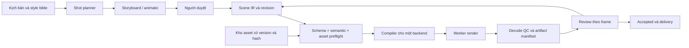

# Kế hoạch triển khai studio nội bộ sau thẩm định

Ngày lập: 10/11/2026. Mục tiêu: kiểm chứng trước khi mở rộng, rồi tạo video 2D/2.5D từ kịch bản với phong cách paper-cut, layered shadow-box và multiplane đã nêu trong Word. Vai trò bên dưới là trách nhiệm, chưa giả định đã có từng nhân sự riêng.

## 1. Phạm vi bản đầu

Đầu vào: kịch bản, style bible, bộ nhân vật/nền/đạo cụ có phiên bản và audio đã duyệt. Đầu ra: MP4 đã kiểm kỹ thuật, source project mở lại được, artifact hash và lịch sử duyệt.

Bản đầu hỗ trợ một họ phong cách cắt lớp, nhân vật ở góc đã chuẩn bị, vài action có giới hạn và camera 2.5D. Paper-cut, multiplane và bóng lớp được dùng trong cùng một hệ biểu diễn. Một kịch bản mới được chia shot, tham chiếu asset và action sẵn có; thiếu góc/pose/đạo cụ thì tạo yêu cầu bổ sung có vị trí cụ thể.

Chọn 1920×1080, 24 fps, SDR và audio 48 kHz làm **profile thử nghiệm đề xuất**, không coi là yêu cầu đã có trong Word. Khóa profile này cho bộ thử đầu để kết quả so sánh có ý nghĩa. Kiến trúc cho phép thêm profile sau khi có test riêng.

## 2. Thứ tự thực hiện và cổng nghiệm thu

| Chặng | Việc thực hiện | Sản phẩm bàn giao | Điều kiện đi tiếp | Chủ trì |
| --- | --- | --- | --- | --- |
| G0 — tính khả thi công cụ | Khóa phiên bản; chạy ví dụ, cảnh dùng chung, seek, concurrency, asset lỗi, decode và sync | Bộ thử và báo cáo lần này | **Đã đạt trong phạm vi fixture nhỏ**; các failure case được chặn bằng cấu hình/primitive đúng | Kỹ sư renderer |
| G1 — cảnh đại diện và chọn backend | Chuẩn bị asset thật; ba shot 10–15 giây; render 1080p; thử sửa một asset/câu thoại; đo công sức và giới hạn | Asset pack, golden frames, raw measurements, ADR chọn một renderer | Đủ chất lượng art đã định nghĩa, không lỗi chặn kỹ thuật; so sánh trên cùng đầu vào và có số liệu sửa shot | Technical artist + renderer + người duyệt |
| G2 — hợp đồng dữ liệu và vòng sửa | Scene IR nhỏ, validator, compiler cho backend được chọn; manifest hash; revision/artifact/review; preflight và output commit | Một shot từ JSON → render → review → revision mới; input lỗi bị chặn | Không có asset ẩn ngoài manifest; review gắn đúng revision/hash; export/open lại được | Kỹ sư ứng dụng/renderer |
| G3 — từ kịch bản sang đề xuất cảnh | Shot planner, tra asset, chọn action, sinh patch trong phạm vi; review storyboard/animatic; một agent dùng tools có contract | Kịch bản ngắn → shot list/animatic → render draft, có trace và lỗi rõ | Validator chặn input sai; agent không tự duyệt nghệ thuật hoặc ghi đè bản accepted | Kỹ sư AI + người duyệt |
| G4 — audio và pilot | Thu/sinh voice, alignment, mouth cues; mix; làm pilot 60–90 giây, khoảng 6–9 shot; thực hiện hai vòng sửa có chủ đích | Phim pilot, source project, số giờ sửa/duyệt, usage và cost per accepted minute | Người duyệt chấp nhận; không lỗi sync/continuity chặn giao; có số liệu chi phí thực | Producer + artist/animator + sound |
| G5 — vận hành studio | Worker restart/cancel, timeout, cache invalidation, restore backup, quota; UI review theo frame; quy trình nâng cấp | Runbook, bộ regression, dashboard job và release nội bộ | Kill/retry không công bố file dở; restore được dự án accepted; truy ra nguồn mọi output | Platform + renderer |

Đưa manifest, job record và publish artifact an toàn vào G2; G5 mới bổ sung đầy đủ kiểm tra sự cố và vận hành. G3 dùng một agent đảm nhiệm nhiều vai logic. Chỉ tăng số agent, renderer hoặc worker khi số liệu chỉ ra nhu cầu cụ thể.

## 3. Việc cần làm ngay ở G1

1. Tạo một character pack có đầu/thân/tay/chân riêng, pivot/anchor, hai expression và bộ hình miệng tối thiểu phù hợp style; một cốc có điểm cầm; một nền có ba lớp và overscan. Có frame trung tính và pose cực trị được duyệt.
2. Shot A: nhân vật nhìn, với, nhấc rồi đặt cốc. Kiểm contact, đổi attachment, trọng lượng và drawing khi rig không đáp ứng. Shot B: camera pan qua multiplane, foreground che một phần nhân vật, bóng lớp và mask. Shot C: câu thoại thật kèm thay biểu cảm; chỉ chấm lip-sync sau khi audio được duyệt.
3. Trước khi dựng chi tiết, duyệt storyboard/animatic và 3–5 frame mục tiêu. “Paper-cut” mô tả phương pháp; frame mục tiêu mới xác định chất lượng cần đạt.
4. Dùng cùng asset và evaluator cho cả hai backend ở phép thử hình tương đương; làm thêm một tác vụ chỉnh sửa theo workflow native để đo công sức tác giả. Ghi mọi khác biệt và bước bake.
5. Chạy ba lượt cold process và năm lượt warm cho mỗi cấu hình; ghi rõ cache nào được giữ/xóa. Với tám mẫu chỉ công bố từng mẫu, median và phạm vi; chưa dựa vào p95 để ra cam kết. Nếu cần SLA p95, thiết kế tập lớn hơn và workload đại diện.
6. Tăng tải theo từng trục: layer 10/30/60; nhân vật 1/5/20; blur/mask bật tắt; texture 1K/2K/4K; worker 1/2 trong ngân sách RAM. Dừng khi gặp OOM, sai hình hoặc chạm giới hạn tài nguyên đã đặt.
7. Đổi một palette/asset và một câu thoại. Ghi phút thao tác/sửa/duyệt và shot nào bị render lại. Thử lại sau khi sửa; lưu cả kết quả trước/sau.
8. Viết ADR: yêu cầu bắt buộc nào đạt, thiếu gì, tổng công sức và chi phí ước tính từ số đo. Chọn một backend cho MVP. Nếu cả hai cùng vướng asset/rig, sửa representation hoặc phạm vi trước khi đổi renderer.

Timebox quản trị đề xuất cho G1: **5 ngày công kỹ thuật và 3–5 ngày công chuẩn bị/duyệt hình**, sau khi có người đảm nhiệm các vai. Đây là ngân sách thử và điểm dừng để rà lại phạm vi, không phải lời hứa hoàn tất hoặc số đo năng suất. Nếu hết timebox chưa có cảnh đạt, ghi blocker và thu hẹp action/effect; không tự động bắt đầu G2.

## 4. Bộ kiểm thử phải hoàn thiện

Các ngưỡng dưới đây là ngưỡng kỹ thuật đề xuất cho profile thử 1080p/24 fps, cần khóa trước tập chạy kế tiếp. Chúng không thay thế review nghệ thuật.

| ID | Test và input lỗi | Tiêu chí đạt | Tình trạng hiện tại |
| --- | --- | --- | --- |
| T01 | Asset thiếu, hash sai, font thiếu, URI hết hạn | Chặn trước render; lỗi có assetId/shotId; không fallback âm thầm | Đã tái hiện ảnh thiếu và xác nhận hai biện pháp chặn; hash/font/URI chờ |
| T02 | Seek forward/reverse/random/repeated và browser mới | Logic snapshot giống nhau; raster trong cùng môi trường có ngưỡng cố định; không có ngoại lệ chưa giải thích | Đạt 12 frame mẫu × 4 lượt/backend; mở rộng 1080p và Player scrub |
| T03 | One-worker/two-worker và biên chunk | Đúng frame count; không frame thiếu/lặp; ảnh decoded so baseline đạt dung sai | Đạt 240 frame/backend trên một máy; chưa nhiều máy/chunk dài |
| T04 | Pick/place, swap parent, pose cực trị | Contact ≤2 px tại output 1080p ở các marker, không nhảy transform; mắt người duyệt xác nhận | Mới có pickup đơn giản; chưa place/retarget/ma trận phức tạp |
| T05 | Walk + pan, multiplane/overscan | Không lộ vùng rỗng trong đường camera; chân trụ không trượt quá ngưỡng art đã định | Đã thử pan; walk/contact ground chờ |
| T06 | Layered shadow-box, alpha, mask/blur | So golden trên nền sáng/tối; không viền bẩn; alpha của file decode đúng; range/color được ghi | Mới bóng/mask SVG đơn giản; chưa output alpha/stack nặng |
| T07 | Audio sync, silence, clipping, encode | Frame count đúng tuyệt đối; sync marker ≤1 frame (41,67 ms); audio padding cuối ≤1 AAC frame (~21,33 ms ở 48 kHz); peak/loudness theo output profile | Sync tổng hợp đạt; chưa speech/mix master |
| T08 | Câu thoại thật/ngôn ngữ mục tiêu | Cue gắn transcript+audio hash; đo lệch cue và tỷ lệ câu cần sửa; artist duyệt cận cảnh | Chưa chạy; chuẩn bị tối thiểu 20–30 câu có im lặng, nói nhanh, cảm thán và âm cuối |
| T09 | Input IR sai: chu trình, anchor thiếu, range sai, effect không hỗ trợ | Validator trả lỗi ổn định trước renderer; không bỏ effect âm thầm | Chưa có validator production |
| T10 | Sửa asset/thoại/music gain | Asset/thoại làm stale đúng dependencies; chỉ sửa gain nhạc không render lại hình | Chưa có cache service |
| T11 | Kill/cancel khi load/capture/encode/commit; hai attempt cùng job | Không publish MP4 dở; accepted artifact không bị ghi đè; một commit thắng; subprocess được dọn | Chưa có job runner production |
| T12 | Export/restore project và sửa sau restore | Replay được từ dependency/asset hash; không dùng đường dẫn máy cũ; danh sách mapping mất dữ liệu nếu dùng OTIO | Lockfile và harness đã có; project sản xuất/OTIO chờ |
| T13 | Agent với 20 đề bài hợp lệ và 20 đề bài lỗi có chủ đích | Input nguy hiểm/sai schema bị chặn 100% trong tập; mỗi output có bằng chứng; ghi tỷ lệ cần người sửa | Chưa tích hợp agent |

Chỉ dùng “PASS” khi có testId, input hash, môi trường, ngưỡng và đường dẫn evidence. Các test không chạy có trạng thái `NOT_RUN`; thiếu dữ liệu có trạng thái `BLOCKED_INPUT`. Không đổi chúng thành PASS vì một demo ngắn chạy được.

## 5. Kiến trúc MVP đề xuất

Một ứng dụng Node/TypeScript, một worker render và kho local theo hash đủ cho vòng đầu. SQLite có thể giữ trạng thái/quan hệ khi chỉ có một tiến trình điều phối; dùng file manifest bất biến cho artifact lớn. Chuyển cơ sở dữ liệu/object store/queue khi tải và số người dùng nội bộ đòi hỏi. Chưa có lý do từ phép thử này để chọn Kubernetes, render phân tán hay đồng thời Temporal + LangGraph.

Scene IR v0.1 chỉ cần: project/shot ID, fps dạng phân số, canvas/profile, durationFrames, assetRef có hash, instances, coordinate convention, controls/curves, camera, audio refs/cues và output profile. Dùng khoảng [startFrame, endFrameExclusive). Định nghĩa world/local/screen space, điểm gốc, đơn vị, transform order và cách đổi parent bằng văn bản và fixture. Action không hỗ trợ trả lỗi; drawing thủ công có version là một đường xử lý hợp lệ.

Các thực thể chính:

| Thực thể | Bất biến phải giữ |
| --- | --- |
| AssetRevision | Bytes/hash không đổi sau khi approved; quyền và dependencies có hồ sơ |
| ShotRevision | Snapshot IR; trỏ asset/rig/action version cụ thể; sửa tạo revision mới |
| RenderJob | Một revision + output profile + environment digest; có nhiều attempt |
| Attempt | Log, heartbeat, trạng thái, vùng tạm và tài nguyên riêng |
| Artifact | Chỉ công bố sau decode/QC; hash, frame count, audio và profile được lưu |
| Review | Tham chiếu đúng ShotRevision và Artifact hash; ghi người duyệt và comment/frame |

Asset preflight → render vào thư mục attempt → decode/QC → atomic commit manifest → art review. Không đánh dấu accepted khi chỉ có `exit 0` hoặc file MP4 đã xuất hiện.

## 6. Backlog ưu tiên sau G1

| Thứ tự | Công việc | Phụ thuộc | Bằng chứng hoàn thành |
| --- | --- | --- | --- |
| 1 | Quyết định renderer bằng ADR và đóng cấu hình strict/asset-ready | G1 | ADR + fixture + log quyết định |
| 2 | Asset manifest, rights, hash checker và project packaging | 1 | Sai hash/asset thiếu bị chặn; export tự đủ |
| 3 | IR schema + semantic validation + capability matrix | 1–2 | Corpus input hợp lệ/lỗi chạy tự động |
| 4 | Compiler, evaluator và 4–6 action cần cho pilot | 3 | Golden frame, contact report; artist duyệt |
| 5 | Job/attempt/artifact/review tối thiểu | 2–3 | Một revision render lại hai profile, không lẫn review |
| 6 | UI xem video, scrub frame, comment và so revision | 5 | Sửa một lỗi tại đúng frame, duyệt đúng artifact |
| 7 | Shot planner/agent sinh IR patch theo tool contract | 3–6 | Evaluation set; patch vượt phạm vi bị chặn |
| 8 | Voice/alignment/cues, stems và mix | 2–4 | Corpus audio thật + sửa cue; sync sau encode |
| 9 | Pilot và đo chi phí trên phút được duyệt | 4–8 | Video accepted + usage + giờ làm/sửa/duyệt |
| 10 | Cache/recovery/backup và regression khi nâng phiên bản | 5, 9 | T10–T12; restore sạch và render lại |

Từ kịch bản đến animatic có thể làm thủ công trước khi agent hoàn thiện, để đánh giá chất lượng kể chuyện sớm. Đồng thời chỉ có một hợp đồng IR được chốt; asset và audio có thể làm song song sau khi timing/profile thống nhất.

## 7. Quy tắc chọn renderer và ngân sách

Các hard gate: quyền sử dụng phù hợp, asset-ready, frame/timebase đúng, output decode được, cảnh mục tiêu đạt hình và có cách sửa. Sau khi cả hai qua gate, so công sức làm/sửa/duyệt, độ dễ xây review UI, độ ổn định và tổng chi phí. Không lấy tốc độ một fixture làm tiêu chí duy nhất.

HyperFrames hiện có kết quả nhanh hơn trong một fixture nhỏ của lần thử này và phù hợp cách tác giả HTML/timeline. Remotion phù hợp khi phần biên tập/review cần tái sử dụng sâu các component React. Đây là căn cứ để thiết kế thử tiếp; chưa phải quyết định thắng/thua. Giữ một interface render hẹp, triển khai một backend production sau G1.

Ngân sách pilot ghi riêng compute, tạo/sửa asset, voice, license, lưu trữ và giờ người làm/duyệt. Chia tổng cho **phút đã accepted**, tính cả output bị loại và các lần sửa. Không lấy $0,01/render của một gói license làm giá thành video. Không mua thêm hạ tầng chỉ vì tăng worker; kết quả lần này đã cho thấy Remotion hai worker chậm hơn một worker trên workload/máy thử cụ thể.

Chưa đủ dữ liệu để ấn định tổng số tuần hoặc ngân sách toàn studio: nhân lực, số phút/tháng và chất lượng art cần đạt chưa có số đo thực. Sau G1 lập ước lượng các item 1–8 bằng công sức đã quan sát; sau G4 hiệu chỉnh bằng số phút accepted và thời gian sửa. Mỗi chặng có điểm dừng rõ, nên việc khảo sát vẫn tiến được mà không cần một cam kết tổng tiến độ thiếu cơ sở.

## 8. Việc tiếp theo cụ thể

Tiếp tục ở **G1: bộ asset thật và ba shot 1080p**. Bộ thử đã có là mốc kỹ thuật ban đầu; giữ nguyên để phát hiện regression. Đóng F01/F02 trong mọi template/compiler mới. Hoàn thành corpus thoại và một cảnh shadow-box có tải đại diện trước khi chốt renderer, rồi mới viết pipeline agent theo backlog ở trên.

Template biên tập cần ID ổn định cho từng phần tử có thể sửa; không dùng DOM wrapper không có địa chỉ rõ làm mục tiêu patch. Biến thể HyperFrames đã sửa cảnh báo ở F08 có thể dùng làm ví dụ nhỏ cho quy tắc này.
