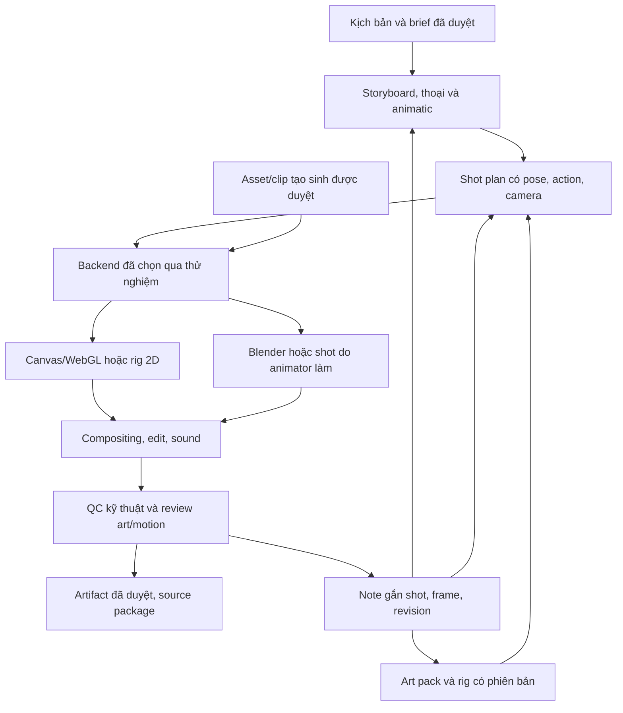

# Nghiên cứu nâng chất lượng hình ảnh và chuyển động lên production

Ngày khảo sát: **11/11/2026**. Phạm vi: đọc tài liệu, kiểm tra mã nguồn, xem ảnh tham chiếu và lập kế hoạch. **Chưa triển khai backend mới, chưa chạy benchmark mới, chưa gọi dịch vụ trả phí.**

Tài liệu nền: Word gốc `Bao_cao_Studio_hoat_hinh_AI_HyperFrames_Remotion.docx`, thẩm định trước, demo v0.1 tại commit `b79ec76497b7cb57f753f596cb60969aae3383d2`. Phản hồi mới của người dùng: demo phù hợp để minh họa, chất lượng production chưa đạt. Phản hồi này không đồng nghĩa duyệt hình ảnh cho sản phẩm chính thức.

Đọc cùng: [kế hoạch theo giai đoạn](../docs/production-quality-plan.md), [nguồn và giấy phép](../docs/research/production-quality-sources.md), [manifest nguồn đã đọc](../docs/research/production-quality-evidence.json). Các nhận định khả năng áp dụng bên dưới là **đánh giá kỹ thuật**, chưa phải kết quả thử nghiệm trên nội dung của studio.

## 1. Kết luận để ra quyết định

**Nên xây studio kết hợp thiết kế nghệ thuật với tự động hóa có kiểm soát.** Giữ lớp quản lý dự án, revision, job, review và export của v0.1 làm nền. Đầu tư tiếp vào art pack, rig, diễn xuất, bố cục/camera và compositing. Renderer là một phần của chuỗi này.

Ưu tiên nghiên cứu chuyển sang thử nghiệm sau khi duyệt kế hoạch:

1. **Lemo-Opuscar + ClaudeAnimationBase:** tham khảo có chọn lọc kỹ thuật vật liệu, hình vẽ, pose, timing và review; chuẩn hóa thành thư viện nhỏ do studio kiểm soát. Đây là nhánh thử đầu tiên gần stack hiện tại và ba phong cách trong Word.
2. **Blender 2.5D/Grease Pencil:** nhánh đối chứng bắt buộc cho lớp giấy, bóng, ánh sáng và camera có chiều sâu. Nếu vượt nhánh code về chất lượng đã duyệt, chấp nhận dùng Blender làm backend tạo shot dù công tích hợp lớn hơn.
3. **Spine Professional + runtime Pixi chính thức:** nhánh có điều kiện khi thiếu công cụ dựng/sửa rig là nút thắt. Moho Pro hoặc Harmony là lựa chọn authoring nếu đội animator đã có kỹ năng và license phù hợp.
4. **ComfyUI, Qwen-Image-Layered, Wan-Animate, LTX:** nhánh phụ cho asset hoặc shot phù hợp. Chỉ đưa output đã duyệt vào phim; phải đo riêng độ ổn định nhân vật, tiếp xúc và chi phí sửa.
5. **OpenMontage:** học cách điều phối công đoạn, storyboard và review. Không có căn cứ từ phần mã đã đọc để khẳng định thay cả studio bằng OpenMontage sẽ đạt diễn xuất production.

Chưa có bằng chứng để xếp một công cụ là “tốt nhất” cho mọi shot. Cách chọn đề xuất: loại phương án không đạt chất lượng bắt buộc, so công sửa và khả năng tái tạo giữa các phương án còn lại. Nếu không phương án nào đạt, quay lại art/rig/shot design hoặc dùng animation do người làm cho shot khó; không hạ chuẩn để đóng mốc.

## 2. Demo đang thiếu gì, đối chiếu với Word

Đã xem ảnh `artifacts/morning-frame.png`, đọc `src/rig.ts`, kiến trúc/capability và bằng chứng cũ. **Không dùng một ảnh tĩnh để kết luận về chuyển động của cả video.** Các điểm về chuyển động dưới đây được suy ra trực tiếp từ evaluator; mức độ ảnh hưởng thị giác cần chấm trên video ở vòng thử tới.

| Lớp chất lượng | Bằng chứng hiện tại | Việc cần làm để tăng chất lượng |
| --- | --- | --- |
| Thiết kế hình | Một nhân vật hình học, ít đặc điểm nhận diện; nền và bảng màu đơn giản | Model sheet, silhouette, biểu cảm, hình tay/chân, tỷ lệ và art direction được duyệt |
| Vật liệu giấy | Màu phẳng và `feDropShadow`; ba style chia sẻ phần lớn hình học | Mép giấy, texture theo vật thể, độ dày, bóng phụ thuộc lớp/ánh sáng; tránh grain toàn màn hình thay cho vật liệu |
| Chuyển động cơ thể | Walk dùng sinusoid theo thời gian; tốc độ dịch vị trí theo độ dài cảnh | Pha bước gắn quãng đường, giữ chân khi chạm đất, trọng tâm, vào/dừng bước, chuyển hướng |
| Tương tác đạo cụ | Tay/cốc đi theo tọa độ viết riêng cho một action | Grip anchor, các pha reach/grip/lift/hold/place/release, thứ tự che khuất và chuyển quyền điều khiển prop |
| Diễn xuất | Có action hữu hạn; chưa có biểu đồ mục đích, ánh mắt, key pose theo câu | Anticipation, key poses, breakdowns, hold, reaction và chuyển biểu cảm có chủ ý |
| Camera/không gian | Pan là dịch lớp theo tỷ lệ; bố cục gần cố định | Layout từng shot, overscan, lens/framing, focus có lý do, đường camera không làm lộ thiếu art |
| Miệng/thoại | Độ mở ellipse từ năng lượng audio | Viseme, cue có thể sửa, khẩu hình phù hợp biểu cảm và cỡ cảnh |
| Kiểm chất lượng | Có decode, frame count, audio, hash/revision | Review art/motion theo shot; kiểm contact/continuity; không suy ra “đẹp” từ MP4 hợp lệ |

Word gốc đã nêu nhiều điểm này: chương 2 về chất lượng có thể duyệt; chương 8 về asset; chương 10–12 về rig, camera, khẩu hình; P2/P5/P6/P7/P10 còn mở. Vì vậy cần **hoàn thiện các phần production còn thiếu**, giữ kết quả prototype đã có. Một nhãn `paper-cut` hoặc việc tăng lên 4K không thay thế art pack và diễn xuất.

Phân biệt ba hướng trong Word:

- **Paper-cut:** hình cắt có quy luật nét, mép, khớp và vật liệu nhất quán.
- **Layered shadow-box:** hộp/lớp có quan hệ chiều sâu và bóng; phải thiết kế lớp nào che/đổ bóng lên lớp nào.
- **Multiplane:** cách bố trí và chuyển camera qua các lớp; có thể dùng cùng paper-cut hoặc shadow-box, không nhất thiết là một thiết kế nhân vật khác.

`shadow-puppet` của Lemo là sân khấu rối truyền sáng, **khác vật liệu với layered shadow-box trong Word**. Nó là nguồn tham khảo IK, texture và ánh sáng; không tự đổi hướng nghệ thuật của dự án sang rối bóng.

## 3. Đúng dự án nào, phần nào thực sự hữu ích

Tên người dùng ghi chưa có link xác nhận. Hai ứng viên khớp gần nhất là **OpenMontage** và **Lemo-Opuscar**. Nghiên cứu cũng tách **Montage AI của mfahsold** để tránh chọn nhầm. SHA đầy đủ và file đã đọc nằm trong manifest; các nhận định chỉ áp dụng cho snapshot đó.

### 3.1. OpenMontage — điều phối mạnh hơn bằng chứng về rig tổng quát

Nguồn: [repo chính chủ](https://github.com/OpenMontageInc/OpenMontage), [bộ dựng/QA nhân vật đã đọc](https://github.com/OpenMontageInc/OpenMontage/blob/fecb9a1e3cc23ef84de30b272059457a427f16f8/tools/character/character_animation.py), [pipeline nhân vật](https://github.com/OpenMontageInc/OpenMontage/blob/fecb9a1e3cc23ef84de30b272059457a427f16f8/pipeline_defs/character-animation.yaml).

README trình bày workflow từ brief tới dựng phim, Backlot để xem storyboard/take, và demo dùng nhiều backend. Một số demo dùng video tạo sinh; một số dùng Blender hoặc composition bằng code. Chất lượng của chúng đến từ cả media và công đoạn cụ thể, không thể quy toàn bộ cho lớp orchestration.

**Kiểm tra tĩnh quan trọng:**

- `SvgRigBuilder` tạo bộ parts/pivots mẫu; chính mã ghi pivots là ước lượng vòng đầu.
- `PoseLibraryBuilder` có pose cơ bản; action phát sinh có thể chỉ có `parts: {}`. Có tên action chưa chứng minh đã có diễn xuất tương ứng.
- `CharacterRigRenderer` phần đã đọc dựng hình và timeline bounce/gaze/blink/arm theo mẫu. Chưa thấy trong phần này một hệ thực thi tùy ý mọi action của kịch bản.
- `CharacterAnimationReviewer` gán `motion_detected` từ `actions_timed`; cờ browser/frame review được truyền vào. Đây là kiểm artifact tĩnh, không phải phép đo motion hoặc đánh giá nghệ thuật độc lập. Mã cũng ghi rõ cần kiểm browser/FFmpeg tiếp.

**Nên học:** checkpoint theo công đoạn; take/contact sheet; audit trail; phân biệt provider/asset/render. **Cần chứng minh thêm:** rig được điều khiển đúng nội dung, QA motion thật và khả năng sửa một shot mà giữ phần đã duyệt. Các kết luận này không phủ nhận những pipeline khác chưa kiểm sâu trong repo.

Root license hiện tại là **AGPL-3.0**; một số skill khai MIT riêng. Phải xét đúng file/module và cách tích hợp trước khi tái sử dụng, không coi cả repo là MIT.

### 3.2. Lemo-Opuscar — nguồn tham khảo sát bài toán hình ảnh nhất

Nguồn: [repo và gallery](https://github.com/lemomo-ai/lemo-opuscar), [paper-popup](https://github.com/lemomo-ai/lemo-opuscar/blob/9eb7739a0fca4c6990fe966cb8b87b1930f7193a/styles/paper-popup/STYLE.md), [shadow-puppet](https://github.com/lemomo-ai/lemo-opuscar/blob/9eb7739a0fca4c6990fe966cb8b87b1930f7193a/styles/shadow-puppet/STYLE.md).

Snapshot công bố **66 style**. Đây là số thư viện của tác giả, không phải 66 kiểu rig tổng quát đã được studio kiểm. Đã xem hai poster gốc; chưa xem/chấm toàn bộ phim và chưa tái render demo.

**Điểm có thể học trực tiếp từ source:**

| Thành phần | Cơ chế đã đọc | Giá trị cho studio |
| --- | --- | --- |
| Paper-popup actors | Canvas art trên plane Three.js, mặt trước/sau, alpha depth material, cập nhật texture theo pose lượng tử hóa | Lớp giấy có bóng theo silhouette; hình 2D nằm trong không gian có ánh sáng |
| Shadow-puppet | Cấu trúc puppet và solver IK hai đoạn trong `houyi.js` | Tay đi tới đích; prop và chi tiết có quy tắc transform rõ |
| Style prompt | Quy định vật liệu, màu, camera, motion và lỗi thường gặp | Chuyển “phong cách” thành bản thiết kế kiểm được |
| Core renderer | `render(t)`, readiness, still/contact sheet, mux/audio check | Review sớm theo frame và tách dựng hình khỏi xuất video |

Ảnh paper-popup cho thấy đường viền giấy, lớp cảnh và bóng có chủ ý rõ hơn fixture của studio. Đây là **quan sát ảnh tĩnh**, chưa chứng minh chuyển động/hiệu năng trên nhân vật mới.

**Giới hạn cần xử lý:** engine trong mỗi demo có các nhân vật và tình huống viết riêng. Không nên nhập nguyên demo rồi gọi là registry/rig đa nhân vật. `core/render/page.mjs` cho phép một số image/font/fetch thiếu chỉ cảnh báo; production cần manifest phân biệt required/optional và chặn thiếu asset bắt buộc. Khả năng chạy WebGL ở máy vận hành còn phải đo.

Code/docs MIT; demo/still CC BY 4.0 và có ngoại lệ voice, asset bên thứ ba. Lưu nguồn/notice nếu dùng lại; xây art/nhân vật riêng của studio. Những lời hứa phụ thuộc model trong README là tuyên bố tác giả, không phải yêu cầu mua model hay bảo đảm tái tạo chất lượng.

### 3.3. ClaudeAnimationBase — timing và diễn xuất bằng code đáng học

Nguồn: [repo](https://github.com/JohnHeibel/ClaudeAnimationBase), [core](https://github.com/JohnHeibel/ClaudeAnimationBase/blob/0ac8bf2b31942376cb6b8c4074715595d512acd2/src/core.js), [nhân vật](https://github.com/JohnHeibel/ClaudeAnimationBase/blob/0ac8bf2b31942376cb6b8c4074715595d512acd2/src/clawd.js).

Starter p5.js/p5.brush, thiết kế quanh một nhân vật mẫu. Source có anticipation cho jump/take, arc, spring suy giảm, đổi view, bước đi theo quãng đường, helper giữ drawing hai frame và hình mắt/miệng riêng. Đó là khoảng nâng cấp cụ thể so với evaluator hiện tại. Walk theo quãng đường vẫn cần kiểm foot contact; không mặc định tương đương solver giữ chân.

Nên dùng để thiết kế action có nhịp và thư viện review; cần chuyển sang nhân vật của studio, tách dữ liệu khỏi code chuyên biệt. MIT cho code không tự giải quyết quyền nhân vật/asset mẫu. Tác giả cảnh báo watercolor fill có thể chậm; **chưa có số đo máy của ta**. Không áp dụng quy tắc “camera luôn di chuyển” cho mọi cảnh; cảnh đứng vẫn có giá trị kể chuyện.

### 3.4. Montage AI — phục vụ dựng footage, không trực tiếp nâng rig

Nguồn: [repo](https://github.com/mfahsold/montage-ai), [LICENSE đã kiểm](https://github.com/mfahsold/montage-ai/blob/2e9dc03bfd0c320cf30f2762791bcccfd1d12b06/LICENSE).

Workflow chủ yếu phân tích footage, cắt theo nhạc, reframe, grading và bàn giao timeline. Có ích khi studio đã có các shot tốt và cần dựng bản nháp. Không phải ưu tiên để giải quyết tạo hình nhân vật, trọng lượng cơ thể hoặc contact. License tại snapshot là **PolyForm Noncommercial 1.0.0**; không đưa thẳng vào studio dùng cho lợi ích thương mại. Có thể tham khảo khái niệm editorial; lựa chọn tích hợp cần quyền phù hợp.

## 4. Mở rộng công cụ theo đúng vai trò

| Hướng | Điểm có thể nâng chất lượng | Hạn chế/việc phải chứng minh | Vai trò đề xuất |
| --- | --- | --- | --- |
| Canvas/WebGL/Three + các kỹ thuật Lemo | Hình vẽ theo style, vật liệu, camera, shader; tích hợp web thuận | Cần authoring rig/action, xử lý alpha/color và render deterministic | Nhánh A bắt buộc thử |
| Blender: cutout planes + armature; Grease Pencil khi phù hợp | Layout 2.5D, ánh sáng/bóng, đa góc, animation và compositing | Art/rig mất công; migration Grease Pencil/addon; color và simulation phải khóa | Nhánh B đối chứng chất lượng |
| Spine Professional + Pixi | Rig có editor; IK, mesh/weights, secondary motion; preview web | License; thiếu hình cho góc quay vẫn phải vẽ; physics runtime cần xử lý seek | Nhánh C khi rig authoring là nút thắt |
| Moho Pro | Smart Bones, đổi bộ drawing/rig, IK, camera multiplane | Công cụ thương mại; desktop macOS/Windows; phải thử đường export/automation | Authoring bởi animator, nếu đội phù hợp |
| Harmony | Công cụ cutout/deformation cho đội animation | Chưa kiểm tích hợp/export/license edition; không giả định đầy đủ từ trang giới thiệu | Lựa chọn khi có đội đã dùng Harmony |
| OpenToonz | Vẽ/paint, Xsheet, compositing; hỗ trợ quy trình do artist làm | Cần thử adapter và công sửa; không tự biến script thành diễn xuất | Shot cần drawing hoặc bổ sung pose |
| Qwen-Image-Layered | Tách ảnh thành nhiều lớp RGBA, có xuất PSD trong app mẫu | Layer không bảo đảm là khớp giải phẫu; vùng khuất/overscan vẫn phải duyệt | Hỗ trợ chuẩn bị asset |
| ComfyUI + Wan-Animate | Workflow có node; drive bằng video/ảnh nhân vật | Giữ kiểu dáng, bàn tay, prop/contact và sửa cục bộ phải đo | Thử shot tạo sinh có giới hạn |
| LTX | Nhiều pipeline image/video/control/retake | Nhu cầu GPU, license model, giữ style và revision chưa đo | Đối chứng tạo sinh tự host |
| Google/Runway và provider qua API | Thêm lựa chọn video/ref/edit mà không tự vận hành model | Phí mọi take; endpoint thay đổi; quyền/region; khả năng sửa phải thử | Nhánh paid tùy chọn sau khi chốt ngân sách |
| OpenTimelineIO | Trao đổi clip, timing, track, marker giữa pipeline và editor | Media nằm ngoài timeline; adapter có thể mất effect | Handoff cho dựng/composite thủ công |
| VBench | Tham khảo chiều đo consistency/motion/quality | Không có thước đo tự động nào trong khảo sát chứng minh “đạt art target” | Tín hiệu QC phụ, không tự duyệt |

Nguồn từng dòng: [S01–S18 trong sổ nguồn](../docs/research/production-quality-sources.md). Hàng Harmony mới ở mức tài liệu được tìm thấy; trang mở trực tiếp lỗi 404, nên chưa vào nhánh thử bắt buộc.

### Các chi tiết dễ dẫn đến quyết định sai

**Spine và deterministic render.** Có runtime Pixi chính thức; phiên bản major/minor phải khớp editor. Physics cần trạng thái: bật deterministic trong editor không tự làm runtime seek được. Cần reset + mô phỏng bước cố định từ mốc, hoặc lưu kết quả đã tính phù hợp. CLI export ảnh/video cần windowing/OpenGL theo tài liệu, không đồng nghĩa export headless hoàn toàn. [Nguồn Spine](https://us.esotericsoftware.com/spine-pixi), [physics](https://en.esotericsoftware.com/spine-physics-constraints), [CLI](https://en.esotericsoftware.com/spine-command-line-interface).

**Blender.** Đã kiểm source Armature cho Grease Pencil và các tùy chọn CLI/Python ở commit khóa. Đây là bằng chứng khả năng kỹ thuật, chưa chứng minh shader, rig hay addon cụ thể sẽ chạy đúng. Bản triển khai phải chọn release ổn định, không lấy main khảo sát làm bản production mặc định. Manual mở trực tiếp bị lỗi fetch; sổ nguồn ghi rõ giới hạn này.

**Lip-sync.** Rhubarb là ứng viên CLI tạo cue; tài liệu phân biệt recognizer tiếng Anh và phonetic cho ngôn ngữ khác. Phonetic không phải bằng chứng chất lượng tiếng Việt. Word timestamp từ ASR cũng không tự thành viseme. Cần bộ câu tiếng Việt, mouth mapping theo rig và chỉnh tay; cận cảnh phải có review người. [Rhubarb README](https://github.com/DanielSWolf/rhubarb-lip-sync/blob/9b9573cd21b253c9ba58739bbd1aa0b50b991bff/README.adoc).

**GPU của Wan.** README nêu cấu hình 24 GB cho lệnh TI2V-5B cụ thể; các lệnh 14B khác nêu 80 GB. Không được lấy “chạy 24 GB” làm yêu cầu chung cho Wan-Animate/14B hoặc mọi độ phân giải. Cần khóa checkpoint, precision, offload, frames và đo peak VRAM. [Nguồn](https://github.com/Wan-Video/Wan2.2/blob/1ea34ff48f87168174e12956e200b1d908b1c5ff/README.md).

**License model khác license code.** Snapshot LTX có code Apache-2.0, LTX-2.5 theo LTX-2.x Community License, LTX-2.3 theo license khác; license 2.x có điều kiện doanh thu. Qwen-Image-Layered Apache-2.0 không cho phép suy ra mọi model mang tên Qwen đều như vậy. Không dùng metadata repo để suy ra quyền toàn bộ checkpoint/LoRA/asset.

**API thay đổi.** Tài liệu Google được mở ngày khảo sát thông báo các Veo 3.1 Preview trên Gemini API dừng ngày 22/10/2026, chỉ đường chuyển endpoint/model. Vì vậy một demo cũ gọi được chưa chứng minh tích hợp hiện nay chạy. Runway có danh mục model nhiều provider; khóa model ID/API version khi thử, không chọn “latest/best” động cho render đã duyệt. [Google](https://aistudio.google.com/docs/video), [Runway](https://docs.dev.runwayml.com/guides/models/).

## 5. Chất lượng cần đạt trông như thế nào

Các yêu cầu dưới đây là đề xuất để người dùng duyệt, chưa phải chuẩn đã đạt:

### Hình ảnh

- Nhân vật nhận ra được ở silhouette, wide và close-up; khuôn mặt/tỷ lệ giữ ổn định giữa shot.
- Texture gắn vào vật thể, không trôi/nhấp nháy ngoài chủ ý; đường viền không có halo khi composite.
- Bảng màu, độ đậm nét, cỡ chi tiết, light/shadow cùng một hệ quy tắc; không dán effect ngẫu nhiên lên cảnh.
- Bố cục dẫn mắt đến hành động; foreground, nhân vật và background tách rõ ở màn hình mục tiêu.
- 2.5D có vùng vẽ bù khi pan/zoom và drawing mới khi quay quá phạm vi góc nhìn; không kéo méo một ảnh để giả mọi góc.

### Chuyển động và diễn xuất

- Mỗi action có mục đích, chuẩn bị, thực hiện và kết quả; không chạy loop idle/talk liên tục để lấp thời lượng.
- Tay giữ đúng vật, chân giữ nền trong pha trụ, thân phản ứng theo trọng lượng; chuyển pose không làm chi tách rời.
- Ánh mắt/head turn dẫn hành động khi cần; biểu cảm thay theo ý câu thoại, không chỉ theo âm lượng.
- Secondary motion có độ trễ/settle hợp vật liệu. Giấy gập, khớp giấy và người mềm không dùng một hệ squash như nhau.
- Chọn cadence theo art direction: có thể xuất 24 fps, drawing giữ hai frame, camera chạy từng frame. Tăng fps/nội suy toàn phim có thể phá chủ ý này.

### Khả năng sửa và tái sử dụng

- Thay một câu thoại, giữ pose quan trọng và nhân vật; sửa camera, giữ diễn xuất; sửa màu áo, giữ timing.
- Mỗi shot có nguồn editable, asset/version và review rõ. MP4 đẹp nhưng phải tạo lại cả phim khi sửa một chi tiết chưa đủ cho studio.
- Shot khó có đường bàn giao animator/compositor và nhập lại output đã duyệt. Đây là một phần của workflow sản xuất.

## 6. Kiến trúc mục tiêu ở mức kế hoạch

Những module mới chỉ là **đề xuất**, chưa tồn tại trong ứng dụng: style bible có phiên bản; registry hình/rig; shot/action/camera curves; cue/viseme editor; backend adapter; asset dependency index; review theo frame; cache theo shot. Giữ nguyên module/state/results v0.1 cho tới khi có nhánh triển khai và migration riêng.

Agent nên lập shot plan, chọn asset/pose/action đã duyệt, đề xuất patch có phạm vi và kiểm lại. Free-form code của model nếu cần nghiên cứu phải qua quy trình review như code; ứng dụng không thực thi tùy ý nội dung script/model. Công cụ authoring và artist chịu trách nhiệm chất lượng art/rig; người dùng giữ quyền duyệt cuối.

## 7. Cách chọn được phương án tốt hơn, tránh demo đẹp nhưng không sản xuất được

Thử **cùng art target và cùng sáu shot**, không bắt mọi backend dùng cùng representation. Canvas, rig editor và Blender được dùng cách dựng phù hợp, nhưng phải ghi riêng thời gian làm asset, rig, diễn xuất, render và sửa. Không so demo có nhiều giờ polish của một bên với fixture hình học mới viết của bên khác.

Sáu shot: cận mặt đổi cảm xúc + nói; walk/stop/turn; pick/hold/place; camera qua nhiều lớp; hai nhân vật chuyền vật; shot cao trào cần pose replacement hoặc biến đổi góc. Giữ shot kỹ thuật cũ làm regression. Render/đo các shot mới **NOT_RUN**.

Đánh giá gồm ba cổng độc lập:

1. **Kỹ thuật:** không thiếu asset/blank/decode lỗi; profile, audio, alpha/color đúng; replay/seek theo contract.
2. **Hình và motion:** người duyệt chấm riêng art, acting, camera, continuity; xem tốc độ thật và frame quanh contact/cut. Không cho điểm trung bình che lỗi nghiêm trọng.
3. **Sản xuất:** hai vòng sửa cụ thể; đo tổng công/take bị loại/chi phí trên thời lượng được duyệt; người khác mở lại source.

VBench có các chiều đo hữu ích, nhưng `motion_smoothness.py` dùng nội suy frame và so sai khác. Với animation giữ hình hai frame hoặc line-boil có chủ ý, điểm đó có thể lệch khỏi mục tiêu nghệ thuật. Đây là suy luận từ cơ chế đã đọc; **không dùng điểm VBench làm cổng duyệt tự động**. [Source](https://github.com/Vchitect/VBench/blob/fd18b3d055cb0fc6f066ca90fe2c3c8cbb698490/vbench/motion_smoothness.py).

Kịch bản thử, tiêu chí, mẫu log, cổng dừng và cách quay lại sửa được quy định trong [kế hoạch chi tiết](../docs/production-quality-plan.md).

## 8. Những kết luận chưa được phép đưa ra

- Chưa xác nhận repo nào render nhanh hơn hoặc đẹp hơn trên art pack của studio.
- Chưa chứng minh production chỉ cần một agent, một prompt hoặc không cần animator/artist.
- Chưa có benchmark tiếng Việt, multi-character, video dài, GPU/chi phí/phút được duyệt.
- Chưa chứng minh tái tạo bit-identical giữa GPU/browser/máy khác nhau; phải tách tính xác định của scene khỏi sai khác raster/encode.
- Chưa xác định năng lực đội, ngân sách dịch vụ và máy vận hành; không chốt lịch giao production từ số sao GitHub hoặc giá một demo của tác giả.

**Đề nghị duyệt tiếp theo:** duyệt kế hoạch và bộ tiêu chí, rồi thực hiện art target + thử sáu shot. Chỉ quyết định backend production sau khi có video, review và số đo sửa thực tế. Toàn bộ phần đã làm của v0.1 và các gate P0–P11 còn mở được giữ trong roadmap.
