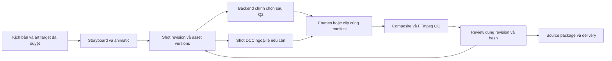

# Nghiên cứu toolchain và kế hoạch mở rộng studio — vòng 2

Ngày đối chiếu: **11/11/2026**. Phạm vi: nghiên cứu, đọc source, chạy harness/CLI có sẵn và lập kế hoạch; **chưa triển khai code sản phẩm**.

## 1. Kết luận để duyệt

Nút thắt lớn nhất là **chưa có art pack, rig và quy trình dựng và chỉnh sửa diễn xuất được duyệt cho các shot thật**. Ứng dụng đã giải quyết được một luồng kỹ thuật hữu ích: kịch bản → draft scene → audio → render → QC → review đúng revision → mở lại dự án. Một nhân vật SVG, năm action định sẵn và miệng theo RMS chưa cung cấp vật liệu giấy, multi-view, contact, foot lock, chuyển trọng lượng và diễn xuất theo ngữ cảnh mà production cần.

Ưu tiên thử **art pack do người hoàn thiện + hai cách dựng và chỉnh sửa hoạt hình**: (A) Three.js/Canvas trong host HyperFrames; (B) Blender 2.5D có animator thao tác. Giữ cách quản lý revision/review hiện tại. FFmpeg phục vụ trung gian, màu, âm thanh và giao hàng ở cả hai đường. Manim Community là ứng viên **shot giải thích/sơ đồ**, chỉ mở khi kịch bản có nhu cầu đó. Chưa có bằng chứng để chọn một công cụ thắng về chất lượng phim của studio.

Khuyến nghị kiến trúc là **C — kết hợp có giới hạn**, nhưng backend chính vẫn là quyết định Q3 sau Q2. “Kết hợp” ở đây nghĩa là giữ source editable ở nơi tác giả làm việc và trao đổi shot có manifest; không xây đồng thời mọi backend. Bước thử đầu chỉ cần A và B; Spine/Moho, Manim hoặc tạo sinh có điều kiện mở riêng.

### Những gì mới so với nghiên cứu trước

- Phân biệt Three.js r187 được đọc source với Three 0.180.0 trong ví dụ HyperFrames; không dùng kết quả của bản này để chứng nhận bản kia.
- Chạy lại harness seek/ảnh thiếu trên HyperFrames **0.9.30 và 0.9.33** trong thư mục nghiên cứu. Hai bản giữ hành vi strict/best-effort của fixture đã thử. Ứng dụng vẫn khóa 0.9.30.
- Xác định rủi ro cụ thể của adapter Three: trường counter mà adapter chờ không có trên native `LoadingManager` r187. Đây là đối chiếu source, chưa phải lỗi đã tái hiện end-to-end; cần ca texture tải chậm/thiếu trước tích hợp.
- Chạy FFmpeg alpha round-trip, negative control mất alpha, kiểm màu và đo loudness demo. Giữ lần encode thiếu metadata và lần sửa cấu hình, không ghi đè evidence.
- Tách Manim Community/ManimGL về package, renderer, source và môi trường. Cài CE v0.22.1 thử trong venv bị chặn bởi `pangocairo`; không đánh giá khả năng của Manim từ lỗi cài đặt này.
- Bổ sung kế hoạch tương lai, điều kiện mở từng nhánh, cơ chế quay lại khi fail và các quyết định cần duyệt. Q0–Q9 vẫn **NOT_STARTED**.

Đọc cùng: [kết quả và cách tái hiện](../docs/research/toolchain-verification.md), [sổ đọc/nguồn](../docs/research/toolchain-reading-and-sources.md), [kế hoạch chi tiết](../docs/toolchain-future-plan.md), [manifest nguồn](../docs/research/toolchain-source-manifest.json).

## 2. Snapshot và mức độ chắc chắn

Repo: https://github.com/maitoan2408/ai-animation-studio-research-content

| Mốc | Kết quả đối chiếu |
| --- | --- |
| Snapshot nghiên cứu gốc | `8e58ffc3133102279f6a3f59b66a38f22d14def0` |
| Nhánh remote nghiên cứu khi bắt đầu | `codex/production-quality-research` vẫn trỏ đúng snapshot; không có delta mới cần hợp nhất |
| Baseline ứng dụng | `b79ec76497b7cb57f753f596cb60969aae3383d2` |
| Nhánh vòng này | `codex/toolchain-research-plan`, tạo từ snapshot nghiên cứu sạch |
| Duyệt của người dùng | Demo phù hợp để minh họa; **chưa đạt production**. Chưa có approval art target, Q2 hoặc release |
| P/M/Q | Giữ M0–M6 và P0–P11 theo hồ sơ cũ; không chuyển PARTIAL thành DONE. Nghiên cứu và CLI tests vòng này không hoàn tất Q0–Q9 |

Nhãn bằng chứng: **RUN** = đã chạy, có input/lệnh/log; **SOURCE** = đọc phần source cụ thể; **DOC** = tài liệu chính thức; **AUTHOR_CLAIM** = công bố chưa đo lại; **PROPOSED** = đề xuất/giả thuyết. Bảng vai trò/phù hợp dưới đây là suy luận kỹ thuật từ SOURCE/DOC, không phải bảng điểm hình ảnh thực đo.

## 3. Đã hiểu / bằng chứng / giới hạn / còn thiếu

| Đã hiểu | Bằng chứng trực tiếp | Giới hạn hiện tại | Cần xác minh tiếp |
| --- | --- | --- | --- |
| Studio nội bộ tạo hoạt hình từ kịch bản, ba hướng paper-cut, layered shadow-box, multiplane | Word §2–3, §11; phản hồi người dùng | Tên phong cách chưa xác định chất lượng cụ thể; shadow-puppet của Lemo khác shadow-box phân lớp | Styleframes, motion references, cadence và scope camera được duyệt Q0/Q1 |
| Planner tạo draft có thể sửa | `src/planner.ts`, tests domain/audio | Paragraph + directive + keyword; chưa LLM hay hiểu cốt truyện | Storyboard/animatic và eval nội dung Q6 |
| Rig hiện tại là evaluator procedural | `src/rig.ts::frameSvg` | Một hình nhân vật, không registry/retarget/multi-view; walk theo hàm tuần hoàn, chưa contact solver | Sáu shot Q2 và extreme pose Q5 |
| Audio có binding/version | `audio.ts`, mixer test, integration snapshot | WAV mono 48 kHz là đầu vào trung gian; MP4 demo thực là AAC **stereo** 48 kHz. RMS không phải viseme | Corpus ngôn ngữ, cue editing, nghe duyệt Q5 |
| Render/QC có chặn lỗi kỹ thuật | `render.ts`, harness cũ + vòng này | QC app chưa kiểm color tags, alpha, LUFS, clip warning mọi loại, contact hoặc nghệ thuật | Media contract/QC Q7 |
| Review giữ đúng revision/artifact | `store.ts`, `application.ts`, unit/HTTP/UI tests | “approved” trong test là dữ liệu giả. UI preview SVG chưa dùng audio envelope như video | Approval thật, proxy/final parity, workflow sửa Q6 |
| Dữ liệu có thể mở lại | Export/import hash tests và gói demo | Một revision + audio; chưa bàn giao rig/DCC/history/OTIO | Restore toàn lịch sử và package shot editable Q4/Q7/Q8 |
| Runtime một writer/worker | Store lock, queue, recovery tests | Persisted running state khác SIGKILL/power-loss tại mọi điểm; cache toàn project | Fault matrix, dependency cache, hardware rehearsal Q7 |

## 4. Đối chiếu Word → kế hoạch → code → tests → khoảng trống

| Word/PDF | Kế hoạch nối tiếp | Code thật | Tests chứng minh | Phần chưa đạt |
| --- | --- | --- | --- | --- |
| §2, §3, §11; tr.6–7,23–24: hình/chiều sâu do art direction | P0/P2, Q0/Q1 | Enum ba style; palette/parallax/frame/mask SVG | Ba style render được trong integration cũ | Không có style bible/model sheet được duyệt; gọi tên style không chứng minh đạt style |
| §5, §15; tr.10–11,30–31: storyboard/animatic/agent | P8, Q6 | Parser và skill contracts/API | Input sai, conflict bị chặn | LLM, semantic planning, animatic timing/review chưa triển khai |
| §9; tr.19–20: asset có lớp, bounds, rights | P5, Q4 | Asset kind hiện chỉ audio; content hash | Corrupt audio/package bị từ chối | Ingest hình/rig, hidden regions, alpha, provenance và dependencies |
| §10; tr.21–22: action phases/contact/weight | P6, Q2/Q5 | idle/wave/walk/pick-up/talk | Pure-frame seek ổn định cho fixture | Place/release, foot lock, handoff, pose replacement; ổn định không chứng minh diễn xuất |
| §11–12; tr.23–25: camera/timebase | P3/P4, Q2/Q4/Q7 | 24 fps nguyên frame; local scene; pan | Boundary và seek mẫu | Camera perspective/overscan/alpha shadow; simulation/replay khác GPU |
| §13; tr.26–27: voice/alignment/viseme/stems | P7, Q5/Q7 | eSpeak/WAV, textHash, PCM padding/gain/RMS | PCM boundary và AAC zero-lag correlation cũ | Phát âm/nhịp thoại, cue/viseme, music/SFX stems, loudness gate |
| §14; tr.28–29: IR rộng, capability check | P4, Q4 | Strict schema 1.0; giới hạn 12 scene/240 s | Reject unknown/action/range sai | Không có arbitrary rig/curves/instances; migration chưa có. Giữ DONE **trong phạm vi v0.1** |
| §16; tr.32–34: revision/job/cache/recovery | P9, Q7 | Attempts/cancel/retry/lock/hash/cache | Unit fake + real cancel trong integration cũ | Shot invalidation, stale reason, power-loss/restore; compiler fingerprint còn là chuỗi phải bump thủ công |
| §17–18; tr.35–37: master/delivery/QC | P9/P11, Q7/Q9 | MP4 H.264/AAC, decode/count/profile/hash | Demo 312 frames; phép alpha/color/loudness mới ở môi trường nghiên cứu | App chưa ingest alpha/sequence; output profile, sound master và handoff chưa nghiệm thu |
| §19–21; tr.38–44: benchmark/pilot/cost | P3/P10, Q2/Q8 | Demo 13 s, integration/UI | Workflow được chứng minh; chưa art pilot | Sáu shot cùng brief; phim 60–90 s; hai vòng sửa; công theo vai/phút accepted |
| §22–25; tr.45–48: license/risk/decision | P1/P11, Q1/Q3/Q9 | Lockfile, notices, docs/CI | Hash/clean checkout cũ, verify mới | Rights cho asset/voice/model/tool mới và cấu hình máy vận hành |

**Bản PDF:** đã xem cả 10 sơ đồ trích từ Word, 26 bảng và các trang PDF 23,24,36,40. Hình 6 phân biệt transform hierarchy, draw order và depth; đây là ba cấu trúc cần thiết kế, không phải một API sẵn. Hình 10 vẫn yêu cầu brief/asset trước quyết định backend. Không diễn giải sơ đồ thiết kế thành feature đã có.

## 5. Bốn nhóm công cụ bắt buộc

### 5.1 Three.js — renderer cho cảnh 2.5D, cần quy trình dựng diễn xuất riêng

**Nguồn R01:** r187, commit `7e89746a687bb88271253698fa108b1dd59825d0`, MIT; phát hành 30/10/2026. [Source và phạm vi đọc](../docs/research/toolchain-reading-and-sources.md#r01--threejs).

Lợi ích rõ khi shot cần các lớp hình cắt đặt trong không gian, camera perspective có giới hạn, ánh sáng/bóng theo lớp, material/texture và hậu kỳ có kiểm soát. Có thể dùng plane/mesh phẳng và orthographic camera để giữ ngôn ngữ 2D. Việc dùng engine 3D không buộc dự án chuyển sang nhân vật 3D hoặc quay tự do.

`SkinnedMesh` nhận skeleton/skin indices/weights; engine không tự cung cấp thiết kế rig, art tách lớp, IK cho hand/prop, acting hoặc editor phù hợp artist. `AnimationMixer.setTime(t)` đặt lại mixer/action time rồi update; simulation, callbacks, animation state bên ngoài mixer vẫn cần reset/bake. Không suy ra mọi scene Three đều seek ngẫu nhiên được.

Color cần được khai ở texture, working space và output. Tài liệu Three dùng Linear-sRGB cho phép tính và sRGB cho hiển thị; post-processing cần đường output tương ứng. Với cutout trong suốt phải thử alphaTest/transparent, depthWrite, sort order, double-sided và shadow material. Alpha canvas mặc định/premultiplied không được tự coi giống PNG straight alpha hoặc alpha video. Không để plane trong suốt đổ bóng thành hình chữ nhật.

**Khi chưa cần Three:** text, infographic phẳng, vài lớp pan tuyến tính đã có thể làm bằng SVG/Canvas. Dùng nó chỉ vì muốn “đẹp hơn” làm tăng chi phí shader/assets/preview/capture mà chưa giải bài toán acting. **Thí nghiệm quyết định:** S04 camera/occlusion/shadow + S03 contact với cùng art pack; so công tạo và sửa với SVG/Canvas và Blender, không chỉ render time.

### 5.2 HyperFrames — host/capture/encode; nâng phiên bản có gate

Đúng dự án đang dùng là [heygen-com/hyperframes](https://github.com/heygen-com/hyperframes), npm `@hyperframes/producer`/`@hyperframes/engine` **0.9.30**. Bản phát hành được thấy ở thời điểm nghiên cứu là **0.9.33**, commit `e596be16c901639ce6c18032e56924a9d8e1967d`, Apache-2.0. Đây là hai snapshot độc lập; chưa nâng ứng dụng.

Producer quản compile/capture/audio/encode, Engine cung cấp primitive thấp hơn; timeline/adapter chịu trách nhiệm state. `FrameAdapter` vẫn experimental v0. Adapter Three trong source truyền `__hfThreeTime` và sự kiện `hf-seek`; không tự đặt camera/bone cho mọi scene. Ví dụ chính thức dùng `poseAt(t)`, `buildReady` và `event.detail.waitUntil` để hoàn tất công việc trước capture. Xem [R02](../docs/research/toolchain-reading-and-sources.md#r02--hyperframes).

**Rủi ro cần kiểm trước tích hợp:** `getLoadingManager()` yêu cầu public `itemsLoaded/itemsTotal`; trong `LoadingManager` r187 hai giá trị là biến closure. Import ESM cũng không tự tạo `window.THREE`. Vì thế không được mặc định readiness adapter này đủ cho mọi Three scene. Kết luận giới hạn ở hợp đồng hai phần source đã đọc; runtime có thể có lớp bao khác. Ca slow/missing texture thực tế còn NOT_RUN. Ví dụ path-traced sử dụng readiness tường minh nên không phải ca chứng minh native manager được theo dõi đúng.

RUN vòng này xác nhận 48 capture/bản trên fixture SVG/GSAP, strict chặn ảnh thiếu, best-effort xuất có warning; 12 hash baseline giữa hai version cũng trùng trong quan sát bổ sung. Không đại diện WebGL/physics/remote fonts. Release 0.9.33 có sửa WAV offset/header; fixture cũ chưa kích hoạt đúng regression đó. Viết fixture mới cho lỗi này cần duyệt, hiện NOT_RUN.

Path tracing là **tùy chọn**, không phải điều kiện để paper-cut đẹp. Ví dụ upstream dùng Three 0.180.0/pathtracer 0.0.24/BVH 0.9.5, không dùng r187. Số tốc độ M4 Max do tác giả công bố chỉ là AUTHOR_CLAIM trong bối cảnh khác. Kết quả chạy harness upstream của vòng này được lưu riêng trong [verification](../docs/research/toolchain-verification.md); không lấy vật thể PBR làm bài chấm phim paper-cut.

### 5.3 FFmpeg — bảo toàn và xử lý media

RUN trên **7.1.5-0+deb13u1**; đọc license source tag n7.1.5, commit `3a0867c2bfda4a4d4309ca1a8cbdc6175e67f587`. Build thực có `--enable-gpl`, libx264 và libzimg. Không gọi toàn bộ build này là LGPL thuần. Trang release hiện hành fetch timeout; không suy ra 7.1.5 là bản mới nhất. [R03](../docs/research/toolchain-reading-and-sources.md#r03--ffmpeg).

Vai trò: encode/mux, nối shot, overlay/mask khi profile cho phép, scaling, convert color/range, xử lý âm thanh, đọc metadata và decode QC. Sequence PNG RGBA hoặc EXR là ứng viên trung gian; chọn theo bit depth/color/alpha/khả năng mở của compositor. QTRLE được dùng trong test nhỏ để kiểm alpha, **không tự chốt nó làm master mặc định**. ProRes 4444/FFV1/EXR cần thử profile và decoder cụ thể trước chọn.

- Alpha test 64×64/24 fps/24 frame: QTRLE giữ alpha 127/255 qua decode; H.264 `yuv420p` không có alpha, negative control phát hiện đúng. Chưa kiểm fringe/premultiplied trên art thật.
- Lệnh `scale` + cờ metadata ban đầu giữ matrix/range nhưng không giữ transfer/primaries ở file kiểm. Lần dùng `zscale` khai input/output rõ cho fixture tạo file đủ BT.709. Đây là kết quả cho lệnh/build/input cụ thể; metadata đúng vẫn chưa chứng minh màu nhìn đúng trên mọi player.
- Demo cũ đủ BT.709, limited range, H.264 yuv420p, 312 frame. AAC stereo 48 kHz. Đo đầu vào loudnorm: **−17,84 LUFS**, **−1,55 dBTP**, **LRA 3,50 LU**. Chưa có chuẩn loudness giao hàng được duyệt nên không gọi con số này PASS/FAIL về âm thanh production.

FFmpeg không tự dựng pose, sửa chân trượt, bổ sung vùng ảnh khuất hay quyết định nhịp diễn xuất. Denoise/sharpen/upscale/frame interpolation chỉ mở khi có lỗi cụ thể và không phá cadence on-twos. Không dùng nội suy để biến hoạt hình có chủ ý thành chuyển động trơn mặc định.

### 5.4 Manim Community và ManimGL — chọn theo loại shot

| Thuộc tính | Manim Community | ManimGL |
| --- | --- | --- |
| Repo/package/CLI | `ManimCommunity/manim`, `manim` | `3b1b/manim`, `manimgl` |
| Snapshot đọc | v0.22.1, `16ea443e…`, phát hành 27/10/2026 | v1.7.2, `f427fc67…`, release 13/12/2024; master vẫn có cập nhật 2026 |
| Đường render trong source | Cairo hoặc OpenGL; SceneFileWriter dùng media pipeline/PyAV | OpenGL scene/camera; writer đưa RGBA vào FFmpeg |
| Cách tác giả | Python Scene/construct/play, mobjects, updaters | Python Scene, tương tác/tùy biến OpenGL theo workflow riêng |
| Kết quả chạy vòng này | Cài venv thử bị thiếu pangocairo; render NOT_RUN | SOURCE/DOC; render NOT_RUN |
| Vai trò đề xuất | Sơ đồ, bản đồ biểu diễn, mũi tên, số liệu, giải thích có nhịp | Nhánh có điều kiện nếu cần workflow/shader và đội quen ManimGL |

Cả hai có MIT ở source đã đọc; font, LaTeX, dependencies và asset có hồ sơ riêng. Không dùng examples/API của CE như thể chạy nguyên trạng trên GL. “Manim” không phải một backend duy nhất. [R04/R05](../docs/research/toolchain-reading-and-sources.md#r04--manim-community).

Source cả hai cập nhật mobject theo thời gian; updater có state phải được kiểm, không giả định `Scene.construct()` là hàm render(frame) random-access của studio. Đường tích hợp nhỏ nhất là **render shot/sequence offline → manifest frame/timebase/color/alpha → ráp**, giữ Python source để sửa. Chưa cần adapter live trong browser. Với bản đồ, engine vẽ chuyển động không bảo đảm địa lý/lịch sử chính xác; content review vẫn là đầu việc riêng.

Manim không có bằng chứng giải được rig nhân vật, contact/foot lock và hai vòng sửa của sáu shot. Không thay rig stack bằng Manim chỉ vì demo transform đẹp. Khi chỉ có một sơ đồ phẳng đơn giản, SVG hiện tại có thể đủ và giảm thêm một môi trường Python.

## 6. Ma trận vai trò và lựa chọn có điều kiện

Chữ “hứa hẹn/phù hợp” trong bảng là đánh giá từ SOURCE/DOC, chưa phải chất lượng thực đo. Các nguồn Sxx là [sổ nghiên cứu trước](../docs/research/production-quality-sources.md) ở các commit đã khóa; không tuyên bố đã audit lại toàn bộ upstream.

| Nhóm/công cụ | Khoảng trống giải quyết, chất lượng kỳ vọng | Sửa/tái sử dụng | Tích hợp/vận hành | Quyền và quyết định |
| --- | --- | --- | --- | --- |
| Three.js + HyperFrames | Depth/light/material/camera + host frame | Source/curves sửa được; cần rig và controls riêng | Browser/GPU readiness/color là gate; mới chứng minh fixture | Three MIT, HF Apache; **thử A trước** |
| Blender/Grease Pencil (S05) | Authoring pose, camera, compositing, drawing/2.5D | Animator có editor; giữ .blend và assets | Local có 4.3.2 nhưng chưa trial art; pin release/plugin/color ở Q1 | GPL phần mềm, asset khác; **đối chứng B** |
| SVG/Canvas + GSAP | Baseline ít lớp, shape/text/cutout | Dễ kiểm frame/state, code hiện tại dùng lại được | Chi phí tăng khi rig/filter/layer phức tạp; GSAP không tự giải contact | GSAP standard license, không MIT; **giữ baseline** |
| PixiJS | Nhiều sprite/mesh/particle 2D; Spine runtime | Atlas/rig kiểm soát được, editor cần bổ sung | Ticker phải điều khiển; thêm runtime nếu nhu cầu rõ | MIT cho Pixi, plugin/Spine khác; **điều kiện** |
| Remotion | React composition/player/editor integration | Props/components; không tự tạo art hay acting | Harness cũ đã chạy, app chưa tích hợp; đổi host không tự tăng chất lượng | License riêng theo eligibility; **dự phòng**, chưa làm lại app |
| Lemo-Opuscar (S02) | Paper material, planes, style grammar, shadow-puppet IK | Học kỹ thuật ở module cụ thể; demo nhân vật chưa phải rig tổng quát | Readiness một số asset chỉ warn; cần gate riêng | Code/docs MIT; demo/still/voice có điều kiện khác; **tham khảo A**, không import cả bộ |
| ClaudeAnimationBase (S03) | Anticipation, arcs, hold/on-twos, timing | Các primitive có ích; thiết kế quanh nhân vật cụ thể | p5/brush/time/seed phải kiểm; không tự retarget | MIT source, dependencies/asset riêng; **tham khảo motion grammar** |
| OpenMontage (S01) | Pipeline/artifact/review task orchestration | Hợp đồng công đoạn hữu ích | Module character đã đọc có pose placeholder; reviewer không đo contact thật | Root AGPL, một số skill MIT; **tham khảo quy trình**, chưa chọn renderer |
| Montage AI (S04) | Rough cut footage có sẵn | Editor/timeline, không rig paper-cut | Khác bài toán hoạt hình nhân vật | PolyForm Noncommercial; **chưa đưa vào studio thương mại** |
| Spine Professional + Pixi (S06) | Rig/mesh/constraints khi code khó chỉnh | Editor thuận animator; version runtime phải khớp | Physics cần reset/bake; image export cần OpenGL/windowing | License editor/runtime riêng; **chỉ mở sau bằng chứng A/B cần** |
| Moho / Harmony / OpenToonz (S07–09) | Authoring cutout/deformation/drawing | Giữ native project; xuất shot dễ hơn chuyển toàn constraint | Chưa có export/round-trip test; Harmony chỉ SEARCH_ONLY ở vòng trước | Commercial editions / New BSD tương ứng; chọn **một** khi đội có chuyên môn |
| Krita; Qwen-Image-Layered (R07/S10) | Art phân lớp, sửa mép/vùng khuất, drawing khó | .kra/PSD + layer manifest; tách lớp không phải rig | Krita hợp shot drawing ngắn; Qwen chưa inference | Krita GPL phần mềm; Qwen/checkpoint/input kiểm riêng; **ưu tiên công sửa art**, model tùy chọn |
| Rhubarb / alignment / cue editor (S14) | Đề xuất mouth cues, gắn thoại với hình | Manual cue correction là đường bắt buộc | VI chưa đo; ASR transcript/timestamp không bằng viseme | Rhubarb MIT + dependencies, voice rights riêng; **Q5 theo ngôn ngữ pilot** |
| FFmpeg / OTIO (R03/S15) | Media và editorial handoff | Shot/stems giữ source; OTIO chỉ tham chiếu media | Adapter NLE/effect/timebase phải round-trip | FFmpeg tùy build; OTIO adapter/license pin ở Q1; **FFmpeg dùng chung**, OTIO có nhu cầu mới mở |
| ComfyUI / Wan / LTX / API (S11–13,17–18) | Concept, texture, một shot khó nếu hiệu quả thật | Local edit/identity chưa được chứng minh; lưu mọi take | GPU/model/node/endpoint/seed/output cần pin; phí phải duyệt | Code ≠ weights ≠ asset/voice; **nhánh D tùy chọn**, chưa mua máy/gọi API |

Không thêm framework chỉ để tăng danh sách. Krita được bổ sung cụ thể cho khoảng trống **art/drawing sửa được**; không dựng một compositor tổng quát mới khi có thể nhận sequence. Pixi và Manim chưa cần cùng nằm trong MVP kế tiếp.

## 7. Phản biện và điều chỉnh đề xuất

| ID | Loại phát hiện | Căn cứ và điều chỉnh | Ảnh hưởng kế hoạch |
| --- | --- | --- | --- |
| C01 | Đúng nhưng chưa đủ | Word đã nói art/rig/acting quyết định chất lượng. Demo chỉ hoàn tất workflow hữu hạn; cần art pack trước xếp hạng backend | Giữ Q0/Q1 là gate, không đổi renderer trước |
| C02 | Phạm vi benchmark cũ hạn chế | Hai host dùng chung SVG evaluator chứng minh tương đương kỹ thuật; không đo sức mạnh authoring native | Q2 cho mỗi backend representation phù hợp nhưng cùng brief/beats |
| C03 | Bổ sung source risk | HF Three readiness counter/global mismatch như §5.2 | T-THREE-02 NOT_RUN; không coi strict img test bao phủ WebGL textures |
| C04 | Có phiên bản mới | App 0.9.30, latest được thấy 0.9.33; fixture cũ chưa thử WAV regression mới | Gate upgrade riêng; giữ lockfile app |
| C05 | Sai chi tiết trong tài liệu bàn giao | `docs/verification.md` M2 gọi audio video demo là mono; ffprobe file hash cũ xác nhận AAC stereo. PCM mixer mới là mono | Errata tại đây; Q7 khai channel map, không sửa video hoặc evidence cũ |
| C06 | Thiếu ràng buộc media | FFmpeg encode exit 0 nhưng thiếu transfer/primaries ở phép thử ban đầu | Q7 kiểm file decode/probe, conversion explicit; không chỉ set tags |
| C07 | Kế hoạch cũ cần tách ngưỡng | P7 có sync marker ≤1 frame; Q plan có cue speech ±2 frame | Hai phép đo khác nhau: transport sync vs perceptual cue. Chốt riêng ở Q0/Q5, không nới ngưỡng sau chạy |
| C08 | Cần làm rõ từ “master” | Q7 cũ nói MP4 master. H.264 yuv420p phù hợp delivery/proxy; không giữ alpha/precision hoặc editability cần cho mọi handoff | Chọn intermediate theo shot, delivery riêng; format không thay source package |
| C09 | Thiếu effort authoring | Không có số giờ art, rig, polish, revision của scene thật | Q2 timesheet theo vai, setup vs tái sử dụng; chưa dự toán phút phim từ 13 s demo |
| C10 | Giả thuyết cần giảm phạm vi | Cùng lúc code, Blender, Spine, models sẽ nhân công cụ và khó so sánh | A/B trước; C là cách nối; C/D bổ sung trong Q2 cũ chỉ kích hoạt theo blocker |
| C11 | Cache/preview cần contract rõ | Backend/compiler version trong doctor là chuỗi; SVG preview không mang RMS binding của final | Q4/Q7 dependency fingerprint; Q6 phân biệt storyboard proxy và preview final, cần parity test |
| C12 | Không kết luận từ điều kiện môi trường | Manim thiếu pangocairo, FFmpeg website timeout, Harmony docs chưa mở được | BLOCKED/NOT_RUN/SEARCH_ONLY đúng phạm vi; không ghi tool “không làm được” |

Các nhận định “remotion MIT”, “một prompt tự làm phim đẹp”, “ảnh tĩnh chứng minh motion” không được gán cho Word: báo cáo gốc đã giới hạn các cách hiểu đó. Phần cần sửa là dữ liệu/contract cụ thể và khoảng cách giữa thiết kế với triển khai.

## 8. Bốn phương án kiến trúc

| Phương án | Cấu trúc và lợi ích | Chi phí/rủi ro | Điều kiện chọn hoặc hoãn |
| --- | --- | --- | --- |
| A — chủ yếu bằng code | Art pack → rig/actions/evaluator → Three/Canvas → HyperFrames → FFmpeg; dùng control plane hiện tại | Phải xây controls/pose/contact, artist có thể phụ thuộc dev; WebGL seek/readiness | Chọn khi sáu shot đạt và hai vòng sửa đủ thuận; nếu ảnh/contact fail, sửa art/rig trước |
| B — authoring chuyên dụng | Art/rig/acting/camera trong Blender hoặc một DCC phù hợp → sequence/stems → studio QC/review | Cần animator và native source; exporter/effects/automation/rights | Chọn khi authoring/edit tốt hơn A với art target, chi phí hỗ trợ chấp nhận được |
| C — kết hợp có kiểm soát | Một backend chính + shot thủ công/DCC ngoại lệ; studio quản version/media/review | Màu/alpha/timebase/handoff có thể lệch; nhiều đường lỗi hơn | **Đề xuất có điều kiện**: dùng khi đo được giá trị của backend phụ và contract round-trip đạt |
| D — tạo sinh hỗ trợ | Asset hoặc shot model tạo → tuyển chọn/sửa/composite → pipeline C | Identity/contact/drift/editability, rejected takes, GPU/phí/terms | Chỉ chọn cho nhiệm vụ cụ thể sau so với artist và trần ngân sách; không bắt A/B phụ thuộc model |

Contract handoff dự kiến gồm shot/revision, source hash/tool version, start/end/handles, fps hữu tỉ, native/output size, frame sequence manifest, color transform/range, alpha convention, audio stems/channel map/cues, dependencies/rights và known losses. Đây là **đặc tả cần duyệt**, chưa phải schema/app feature mới.

## 9. Mức chứng minh và bước tiếp theo

Đã có bằng chứng runtime cho nền app và một số thuộc tính host/media; có source review cho công cụ mới; **chưa có A/B sáu shot, art approval, hai vòng sửa hoặc cost/phút accepted**. Không có cơ sở tuyên bố “chất lượng tốt nhất” tuyệt đối hoặc đạt production.

Ba bước tiếp theo cụ thể, sau khi duyệt phạm vi:

1. **Q0:** duyệt style/motion references, hero/brief, output profile và rubric; lấy ba hướng trong Word làm đầu vào, không hỏi lại phong cách từ đầu.
2. **Q1:** tạo art pack có front/3⁄4/profile theo shot, mouth/hand/pose sheet, prop anchors, nền đủ overscan và quyền dùng; duyệt ba styleframe trước animation.
3. **Q2:** chạy A/B sáu shot và hai vòng sửa; thêm ca readiness/alpha/color/seek cần harness mới sau duyệt. Chỉ khi đủ phim/evidence mới Q3 chọn backend và chốt phạm vi code.

Quyết định cần người dùng duyệt: shortlist A/B; style đầu và chuẩn hình/chuyển động; trách nhiệm art/animation và timebox chuẩn bị đo. Ngân sách API/GPU/license mặc định của vòng kế tiếp là **0 cho đến khi có trần riêng được duyệt**. Danh sách quyết định cụ thể và mọi stage/future branch nằm trong [kế hoạch](../docs/toolchain-future-plan.md).
